## Who am I? | Resul Umit

- Associate Professor at <a href="https://www.durham.ac.uk/staff/resul-umit/" target="_blank">Durham University</a>, UK

- Data Editor at <a href="https://www.tandfonline.com/journals/upcp20" target="_blank">Political Communication</a>, from January 2027

- Interested in representation, elections, and parliaments
  - e.g., <a href="https://doi.org/10.1017/S0007123422000618" target="_blank">a publication</a> on the effects of MP rebellion in parliament

- Teaching workshops, also on
  - working with social media data, e.g., from Bluesky
  - automated web scraping
  - creating academic websites

- <a href="https://resulumit.com/" target="_blank">resulumit.com</a> has more about my work

## How did I use to write?

First, with [Stata + Word]{.yellow-h}, I was ...

- frustrated with Word
  - formatting tables, figures, citations, and equations
  - managing references

- tired of switching between programmes and screens
  - and, worried about making mistakes in between

- paying for programme licences

## How did I use to write? (2)

Then, with [Stata + R + LaTeX]{.yellow-h}, I was ...

- ~~frustrated with Word~~
  - ~~formatting tables, figures, citations, and equations~~
  - ~~managing references~~

- tired of switching between programmes and screens
  - and, worried about making mistakes in between

- paying for the Stata licence

- converting PDF documents to Word manually
  - coordinating work with co-authors who do not use LaTeX
  - submitting to journals that do not accept LaTeX or PDF

## How do I write now?

Now, with [R Markdown, and then Quarto]{.yellow-h}, I am ... happy!

- ~~frustrated with Word~~
  - ~~formatting tables, figures, citations, and equations~~
  - ~~managing references~~

- ~~tired of switching between programmes and screens~~
  - ~~and, worried about making mistakes in between~~

- ~~paying for the Stata licence~~

- ~~converting PDF documents to Word manually~~
  - ~~coordinating work with co-authors who do not use LaTeX~~
  - ~~submitting to journals that do not accept LaTeX or PDF~~

## Reproducible Research | Definition

- Research is [reproducible]{.yellow-h} when others can obtain the same results
  - using the same data
  - and the same code, or procedures

- This requires access to, and documentation of
  - the data, including how it was collected and transformed
  - the code, including how it was run, with which software
  - the link between the results and the text that reports them

- Reproducibility is not only for others
  - your future self is your most frequent collaborator
  - e.g., when responding to reviewers, months after submission

## Reproducible Research | Before Publication

- Having written a complete draft
  - with data including re-coded variables, tables, figures, and text with references to specific results
      - e.g., numbers from summary and/or regression statistics

- If you and/or your co-authors decide
  - to reverse a re-coded variable to its original measure
  - and/or, to exclude a subgroup of observations from analysis

- How resource intensive would this revision be?
  - how long would it take?
  - how many programmes would be needed, and how much would they cost?
  - how likely is it that you would make a mistake on the way?
      - there is an inverse relationship between this resource intensity and reproducibility

## Reproducible Research | After Publication

- After your paper is published, if others, including your future self, would like to test how robust the results are
  - to reversing a re-coded variable to its original measure
  - and/or, to excluding a subgroup of observations from analysis

- How resource intensive would this test be?
  - how accessible are the data, the documentation, and the code?
      - e.g., how was the variable re-coded in the first place?
  - how long would the test take?
  - how many programmes would be needed, and how much would they cost?
      - there is an inverse relationship between this resource intensity and reproducibility

## Reproducible Research | Principles

- Keep text, code, and results together
  - so that a change in one updates the others

- Prefer plain text over binary files [@healy_plaintext]
  - e.g., `.qmd` rather than `.docx`
  - readable by any programme, now and in the future
  - suitable for version control

- Automate what would otherwise be manual
  - e.g., copying numbers from R output into text

- Keep a record of versions [@bryan2018]
  - e.g., with Git and GitHub

## Quarto

- An open-source publishing system [@quarto]
  - combines text and code in a single, plain-text `.qmd` file
  - runs the code and inserts the results into the text
  - renders the same source into various formats
      - e.g., HTML, PDF, Word, as well as presentations, websites, books

- Efficient
  - write text, cite sources, tidy, analyse, table, and plot data in one programme and one screen
  - re-do one, more, or all of these with ease
      - decreasing the possibility of making mistakes in the process

- Open source
  - free to use, with a large community of users and developers

## Quarto | R Markdown

- Quarto is the successor of R Markdown [@rmarkdown2018]
  - developed by the same company, Posit, and largely by the same people
  - R Markdown continues to be maintained, but new features go into Quarto

- Quarto is language agnostic
  - works with R, but also with Python, Julia, and Observable
  - does not depend on R, but works well with RStudio

- If you already use R Markdown
  - most of what you know carries over
  - `.Rmd` files can be rendered with Quarto as they are
  - the key differences are in YAML, e.g., `format` instead of `output`, and in chunk options --- see [Part 6](#chunk-options)

## Quarto | Quarto 2

- Quarto 2 is a full rewrite of Quarto, announced in April 2026<sup>*</sup>
  - written from scratch in Rust, and open source like Quarto 1

- It aims for
  - faster rendering, and better error messages while you type
  - a built-in editor for writing collaboratively
  - smoother work between the source and visual editors

- It is [still experimental]{.yellow-h} --- this workshop uses Quarto 1
  - Quarto 1 continues to be developed and maintained in parallel
  - Quarto 2 aims to be backwards compatible, so your `.qmd` files should just work

<span class="footnote">* See the <a href="https://github.com/orgs/quarto-dev/discussions/14325" target="_blank">announcement</a> and this <a href="https://quarto.org/docs/blog/posts/2026-04-06-whats-next-quarto-2/" target="_blank">blog post</a>.</span>

## Git and GitHub

- Research projects have many versions
  - written over a long time, in numerous sittings
  - often by multiple authors, on multiple computers

- Git and GitHub help with
  - keeping track of changes and versions
  - reverting to a previous version when necessary
  - storing versions safely, in multiple places
  - working on the same project with co-authors

- Plain text files, such as `.qmd`, are ideal for this workflow
  - Git can show exactly which lines changed, by whom, and when

## The Workshop | Overview

- Two days, on how to write reproducible research papers with Quarto
  - ~250 slides, 51 exercises, and time for working on your own paper

- Based on re-creating a mock manuscript with Quarto
  - plus, improving its reproducibility and version-controlling it
  - with PDF, Word, and HTML outputs in mind

- Designed for researchers with basic knowledge of R
  - does not cover programming with R, e.g., writing functions
  - the ability to regress, plot, and table in R will be very helpful, but not necessary

- These slides are from my Quarto workshop, run at <a href="https://www.unilu.ch/en/study/study-programmes/masters-degrees/faculty-of-humanities-and-social-sciences/lucerne-master-in-computational-social-sciences-lumacss/" target="_blank">LUMACSS</a> as a course
  - they remain online, at <a href="https://resulumit.com/teaching/qmd_workshop.html" target="_blank">resulumit.com/teaching/qmd_workshop.html</a>

## The Workshop | Contents {#contents-slide}

<br>

::: {.columns}

::: {.column width="50%"}

[Part 1. Getting the Tools Ready](#part1)  
&nbsp;&nbsp;&nbsp;&nbsp;e.g., downloading course material


[Part 2. Introducing Quarto](#part2)  
&nbsp;&nbsp;&nbsp;&nbsp;e.g., creating a new document


[Part 3. Setting Metadata](#part3)  
&nbsp;&nbsp;&nbsp;&nbsp;e.g., defining output formats


[Part 4. Writing Text](#part4)  
&nbsp;&nbsp;&nbsp;&nbsp;e.g., adding emphasis to text


[Part 5. Managing References](#part5)  
&nbsp;&nbsp;&nbsp;&nbsp;e.g., citing sources


:::

::: {.column width="50%"}

[Part 6. Adding Code, Figures, and Tables](#part6)  
&nbsp;&nbsp;&nbsp;&nbsp;e.g., plotting data


[Part 7. Fine-Tuning](#part7)  
&nbsp;&nbsp;&nbsp;&nbsp;e.g., referring to tables


[Part 8. Using Version Control](#part8)  
&nbsp;&nbsp;&nbsp;&nbsp;e.g., integrating Git and GitHub


[Part 9. Collaborating with Others](#part9)  
&nbsp;&nbsp;&nbsp;&nbsp;e.g., working simultaneously with co-authors


[Part 10. Going Further](#part10)  
&nbsp;&nbsp;&nbsp;&nbsp;e.g., using journal formats


:::

:::

## The Workshop | Organisation

- I will go through a number of slides
  - introducing key concepts and syntax; showing examples

- Then we will all switch to RStudio
  - sometimes, I will first demonstrate how to do things in practice
  - at other times, I will wait for you to complete the exercises yourself first
      - before demonstrating how to complete the exercises myself

## The Workshop | Organisation (2)

- You should follow along
  - [minimum expectation] completing the exercises on your machine, and/or
  - [excellent addition] adapting the exercises to your own work
  - [waste of your time] ~~just watching without attempting~~

- Type, rather than copy and paste, the code that you will find on these slides
  - typing is a part of the learning process

- When you have a question
  - ask me, at any time
  - feel free to help each other as well

## The Workshop | Organisation | Slides {.action-slide}

Slides with this background colour indicate that your action is expected, for example:

- following step-by-step instructions, together
  - e.g., installing Quarto<sup>*</sup>, setting up Git

- completing the numbered exercises, on your own
  - e.g., managing references with Quarto

<br>

<br>

<span class="footnote">* If you followed the pre-workshop preparation, you should already have completed these steps. I will cover the relevant slides only briefly and answer any questions.</span>

## The Workshop | Organisation | Slides | Highlighting

- Code and text that go in Quarto documents appear on a gray background
  - e.g., `**bold**`
  - longer code and text have their own lines

- What comes out in output documents appears on a green background
  - e.g., [**bold**]{.inline-output}
  - larger outputs, such as tables, appear on white, within a green frame

- Some text is [highlighted in yellow]{.yellow-h} for emphasis
  - in code, text, or output

- The slides are designed for self-study as much as for the workshop
  - *accessible*, in substance and form, to go through on your own

## The Workshop | Organisation | Schedule

- Two Saturdays, 21 and 28 November 2026
  - each day runs between 9:15 and 16:30
  - with 10-minute breaks roughly every hour, and lunch roughly between 12:00 and 13:15

- Day 1 covers Parts 1 to 5, and possibly the beginning of Part 6
  - from installing the tools to managing references

- Day 2 continues with Parts 6 to 10
  - from code, figures, and tables to version control, collaboration, and journal formats

- In between the two days, convert a document of your own into Quarto
  - e.g., an assignment for another course, a chapter, or an article draft

## The Workshop | Organisation | Your Own Paper

- If you finish an exercise early
  - apply what you have just learned to your own paper
  - there will be dedicated time for your paper at the end as well

- Between the two days
  - apply everything covered on day 1 to your paper
      - e.g., its YAML, headers, emphases, footnotes, and references
  - the paper does not have to be finished, or even render

- At the start of day 2, we will share our progress with the class
  - what we did, and where we got stuck
  
## The Workshop | Aims

- To make you aware of what is possible with Quarto, Git, and GitHub
  - we will cover a broad range of issues --- not all are meant for long-term memory
      - the slides are designed to support self-study after the workshop
  - awareness of what is possible, documentation, and perseverance are often all you need

- To encourage you to write your research with Quarto
  - practice with a mock manuscript (Parts 3--10)
  - apply what you learn to your own paper, from day 1 onwards

# Part 1. Getting the Tools Ready {#part1 .part-slide background-color="#447099"}

::: {.slide-link}
[Back to the contents slide](#contents-slide).
:::

## Materials | Download {.action-slide #download-materials}

- Download the materials from GitHub, at <a href="https://github.com/resulumit/qmd_workshop/tree/materials" target="_blank">github.com/resulumit/qmd_workshop/tree/materials</a>
  - on the webpage, follow

> `Code -> Download ZIP`

<br>

- Unzip and rename the folder
  - unzip to a location that is not synced
      - e.g., perhaps Documents, but not Dropbox or OneDrive
  - rename the folder, `qmd_workshop-materials`, as `yourname-quarto`
      - e.g., `resul-quarto`
      - this will come handy when we collaborate in [[Part 9](#collaboration-setup)]{.yellow-h}

## Materials | Overview

Notice that the folder, after renaming, has the following structure

:::: {.columns}

::: {.column width="50%"}

```
yourname-quarto/
  |
  |- data/
  |  |- journals.csv
  |
  |- image/
  |  |- google_scholar.png
  |
  |- manuscript/
  |  |- apa_7th.csl
  |  |- journals.qmd
  |  |- references.bib
  |  |- reproduce_this.pdf
  |
  |- preparation/
  |  |- preparation_guide.pdf
  |  |- the_test.qmd
  |
  |- solutions/
  |  |- apa_7th.csl
  |  |- journals_after_part3.qmd
  |  |- ...
  |  |- journals_after_part7.qmd
  |  |- references.bib
```

:::

::: {.column width="50%"}


:::

::::

## Materials | Contents | Manuscript

- `manuscript/reproduce_this.pdf`
  - the document that we will re-create with Quarto, with figures and tables from a fabricated dataset<sup>*</sup>
  - the parts that the exercises are about are in black; the rest of the text is greyed out
  - the margin notes show paragraph numbers and exercise numbers, e.g., `¶ 22` and `Ex. 13`

- `manuscript/journals.qmd`
  - the Quarto document that we will work on
  - includes the unformatted text from `reproduce_this.pdf`, to save time
  - major components, such as paragraphs and tables, are numbered and marked in comments to facilitate navigation

<span class="footnote">* The dataset is created with the `fabricatr` package [@fabricatr].</span>

## Materials | Contents | Solutions

- `solutions/journals_after_part3.qmd` to `solutions/journals_after_part7.qmd`
  - how `journals.qmd` should look at the end of Parts 3 to 7
  - `journals_after_part7.qmd` has all exercises on the mock paper completed

- Use them to catch up, or to check your work
  - e.g., after missing an exercise
  - try each exercise yourself first, before you look

<br>

Note that, to catch up, you can replace the contents of

- `manuscript/journals.qmd` with those of the relevant file, and
- `manuscript/references.bib` with those of `solutions/references.bib`

## Materials | Contents | Data

`data/journals.csv`

- a dataset created with the `fabricatr` package [@fabricatr], imagined to explore the Google Scholar rankings of fictitious journals

- includes the following variables
  - **name**: journals (1091 random titles)
  - **origin**: geographic origins (five continents)
  - **branch**: major discipline of journals (four branches)
  - **since**: time of first publication (years)
  - **h5_index**: H5 Index (integers)
  - **h5_median**: H5 Median (integers)
  - **english**: English (1) *vs.* other-language (0) journals
  - **subfield**: subfield (1) *vs.* generalist (0) journals
  - **issues**: number of issues published per year (integers)

## Materials | Contents | Other

- `manuscript/references.bib`
  - a BibTeX file with three fabricated references

- `manuscript/apa_7th.csl`
  - a Citation Style Language file, with the APA (7th edition) style [@apa7csl]

- `image/google_scholar.png`
  - a screenshot of the <a href="https://scholar.google.com/" target="_blank">Google Scholar</a> homepage

- `preparation/preparation_guide.pdf`, and `preparation/the_test.qmd`
  - instructions for the setup, and a minimal Quarto document to check whether your machine can render PDF documents

## Preparation | R {.action-slide}

- Programming language of this workshop
  - created for data analysis, extensible to other purposes
      - e.g., writing reproducible research papers
  - an alternative is <a href="https://www.python.org/" target="_blank">Python</a>, which also works with Quarto

- If you already have R installed, check if it needs updating
  - type `R.version.string` in R to check your current version
  - compare it with the latest release at <a href="https://cran.r-project.org" target="_blank">cran.r-project.org</a>

- Download R from <a href="https://cloud.r-project.org" target="_blank">https://cloud.r-project.org</a>
  - choose the version for your operating system

## Preparation | RStudio {.action-slide}

- A popular integrated development environment (IDE) for R
  - facilitates working with R, Quarto, Git, and GitHub
  - an alternative is <a href="https://positron.posit.co/" target="_blank">Positron</a>

- Download RStudio from <a href="https://docs.posit.co/ide/user/download.html" target="_blank">https://docs.posit.co/ide/user/download.html</a>
  - or, if you already have it, check if it needs updating --- from the RStudio menu, follow:
  
>    `Help -> Check for RStudio Updates`

## Preparation | Quarto {.action-slide}

- Quarto comes bundled with RStudio
  - there is nothing else to install, if your RStudio is up to date

- Check your Quarto version, by typing the following in the `Terminal` tab in RStudio

```{.bash}
quarto --version
```

- Alternatively, download and install Quarto separately
  - from <a href="https://quarto.org/docs/get-started/" target="_blank">quarto.org/docs/get-started</a>
  - this is useful for getting the latest version, or for using Quarto with other editors

## Preparation | TinyTeX {.action-slide}

- PDF outputs require a LaTeX distribution
  - Quarto turns your document into LaTeX, and LaTeX into PDF
  - TinyTeX is a lightweight distribution, designed for this purpose

- Install TinyTeX by typing the following in the `Terminal` tab in RStudio

```{.bash}
quarto install tinytex
```

<br>

Note that

- you may skip this step if you already have a LaTeX distribution
    - e.g., MiKTeX or MacTeX
- TinyTeX installs missing LaTeX packages automatically, as you render documents
- an alternative to LaTeX for PDF outputs is Typst --- not covered in this workshop

## Preparation | Git {.action-slide #install-git}

- Git is a software that keeps track of versions of a set of files
  - it is *local* to you; the records are kept on your computer
  - it is free

- To get this software
  - on Windows, install 'Git for Windows', downloading from <a href="https://gitforwindows.org" target="_blank">gitforwindows.org</a>
      - accept the default settings
  - on Mac, install Git from <a href="https://git-scm.com/downloads" target="_blank">git-scm.com/downloads</a>
      - alternatively, type `git --version` in the `Terminal`; if Git is missing, macOS offers to install it, as part of its command line developer tools

## Preparation | GitHub {.action-slide}

- GitHub is a hosting service, or a website, that
  - keeps a copy of the versions created by Git
  - is *remote* to you, like the Dropbox website
  - is free for our purposes

- Sign up for GitHub at <a href="https://github.com" target="_blank">github.com</a>
  - usernames are public
      - either choose an anonymous username (e.g., `asdf029348`)
      - or choose one carefully --- it becomes a part of your online presence
  - usernames can be changed later

## Preparation | RStudio Project {.action-slide #rstudio-project}

- RStudio allows for dividing your work with R into separate projects
  - each project gets a dedicated workspace, history, and source documents
  - <a href="https://support.posit.co/hc/en-us/articles/200526207-Using-RStudio-Projects" target="_blank">this page</a> explains why projects are recommended

- Create a new RStudio project for the existing<sup>*</sup> workshop directory `...\yourname-quarto` from the RStudio menu:

> `File -> New Project -> Existing Directory -> Browse -> ...\yourname-quarto -> Open`

<br>

<br>

<span class="footnote">* Recall that we downloaded this earlier from GitHub. [Back to the relevant slide](#download-materials).</span>

## Preparation | R Packages {.action-slide}

:::: {.columns}
::: {.column width="65%"}

Install the required R packages

- `quarto` [@quarto_r], for using Quarto from R, e.g., to add extensions

- `dplyr` [@dplyr], for data manipulation

- `ggplot2` [@ggplot2], for figures

- `modelsummary` [@modelsummary], for summary and regression tables

- `usethis` [@usethis], `gitcreds` [@gitcreds], for Git and GitHub

:::

::: {.column width="35%"}
```{r}
#| eval: false
install.packages(
  c(
    "quarto",
    "dplyr",
    "ggplot2",
    "modelsummary",
    "usethis",
    "gitcreds"
  )
)
```
:::
::::

## Preparation | Test {.action-slide}

- Check that your machine is ready to render PDF documents
  - open `preparation/the_test.qmd` in RStudio
  - click the `Render` button

- If everything works, a new file, `the_test.pdf`, will appear in the same folder
  - with a congratulatory message in it

- If not, read the error message and
  - check that you have installed TinyTeX, as shown earlier
  - restart RStudio, and try again
  - ask me for help

## Preparation | Cheat Sheet {.action-slide}

- Download the Quarto cheat sheet
  - available at <a href="https://rstudio.github.io/cheatsheets/quarto.pdf" target="_blank">rstudio.github.io/cheatsheets/quarto.pdf</a>
  - an HTML version is available at <a href="https://rstudio.github.io/cheatsheets/html/quarto.html" target="_blank">rstudio.github.io/cheatsheets/html/quarto.html</a>

- Keep it at hand during the workshop
  - it summarises much of what we will cover

## Preparation | Other Resources, for Later

- Quarto Guide [@quarto_guide]
  - the official documentation, at <a href="https://quarto.org/docs/guide/" target="_blank">quarto.org/docs/guide</a>

- Quarto: The Practical Guide [@quarto_tdg]
  - open access at <a href="https://quarto-tdg.org" target="_blank">quarto-tdg.org</a>

- R for Data Science [@r4ds2023]
  - open access at <a href="https://r4ds.hadley.nz" target="_blank">r4ds.hadley.nz</a>, with chapters on Quarto

- Happy Git and GitHub for the useR [@happygit]
  - open access at <a href="https://happygitwithr.com" target="_blank">happygitwithr.com</a>

- Pandoc User's Guide [@pandoc]
  - available at <a href="https://pandoc.org/MANUAL.html" target="_blank">pandoc.org/MANUAL.html</a>

# Part 2. Introducing Quarto {#part2 .part-slide background-color="#447099"}

::: {.slide-link}
[Back to the contents slide](#contents-slide).
:::

## Quarto Document | Create {.action-slide}

- Create a new Quarto document from the RStudio menu:<sup>*</sup>

> `File -> New File -> Quarto Document... -> Create`

- Save your new document:<sup>**</sup>

> `File -> Save`

- Observe that
  - the document has been saved to your working directory, and
  - it has the `.qmd` extension

<span class="footnote">* For demonstration only --- we will otherwise work with `journals.qmd`. In the dialogue box, uncheck `Use visual markdown editor` for now.<br>** Alternatively, click the Save icon, the floppy disk in the toolbar above the document.</span>

## Quarto Document | Components

:::: {.columns}

::: {.column width="55%"}

Observe also that the document has three components

- [YAML]{.yellow-h}
  - between the pair of three hyphens [-]{.yellow-h}
  - for metadata

- [text]{.yellow-h}
  - written in Markdown
  - for content

- [code chunks]{.yellow-h}
  - between the pair of three backticks
  - for code, and its output
:::

::: {.column width="45%"}
````{.markdown code-line-numbers="|1-4|6-12,18|14-16,20-23|"}
---
title: "Untitled"
format: html
---

## Quarto

Quarto enables you to weave together content and executable code into a finished document. To learn more about Quarto see <https://quarto.org>.

## Running Code

When you click the **Render** button a document will be generated that includes both content and the output of embedded code. You can embed code like this:

```{{r}}
1 + 1
```

You can add options to executable code like this 

```{{r}}
#| echo: false
2 * 2
```

The `echo: false` option disables the printing of code (only output is displayed).

````
:::

::::

## Quarto Document | Editor Toolbar {#toolbar}

Observe also that the editor toolbar offers extended tools for `.qmd` documents

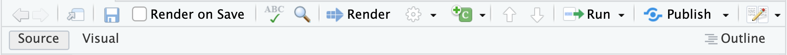{width="100%"}

These include, most importantly,

- the `Render` button, to render `.qmd` documents

- the `Render on Save` option, to render automatically every time you save

- the `Source` and `Visual` buttons, to switch between the two editing modes

## Quarto Document | Render {.action-slide}

:::: {.columns}
::: {.column width="55%"}

- Click the `Render` button to render your `.qmd` document, and observe that
  - the output document has the same name as your `.qmd` document
  - it opens in the `Viewer` tab, or in your browser
      - for HTML outputs
  - `**Render**` in the text has become [**Render**]{.inline-output}
  - the code `1 + 1` has run, and its result, [\[1\] &nbsp;2]{.inline-output}, is shown below it

:::

::: {.column width="45%"}

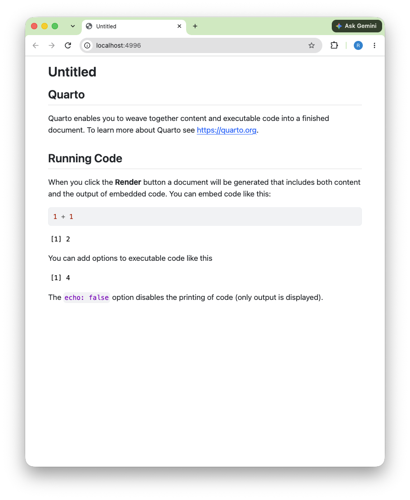{width="100%"}

:::
::::

## Quarto Document | Rendering Process

- When you `Render`, Quarto orchestrates the following:<sup>*</sup>

```
.qmd ---knitr---> .md ---pandoc---> output
```

<br>

- `knitr` [@knitr] executes the code, if there is any, and turns the resulting document into Markdown (`.md`)
  - for documents with Python code only, Jupyter does this step instead


- `pandoc` [@pandoc] transforms the `.md` document into your preferred output format(s)
  - e.g., HTML, Word
  - for PDF outputs, there is an additional step: `.md ---pandoc---> .tex ---LaTeX---> .pdf`

<span class="footnote">* `pandoc` comes with Quarto, while `knitr` is an R package, installed together with the `quarto` package.</span>

## Quarto Document | Source and Visual Editors {#visual-editor}

:::: {.columns}
::: {.column width="55%"}

RStudio offers two modes for editing `.qmd` documents

- `Source` mode shows the plain text, as it is saved
  - you type the Markdown syntax yourself

- `Visual` mode shows a formatted, word-processor-like view
  - with menus and keyboard shortcuts, as in Word
  - the file is still saved as plain text

- You can switch between the two modes at any time
  - but `Visual` [re-writes your whole document]{.yellow-h}
  - and can break syntax, e.g., in tables or code
  - hence, we will use `Source` mode only

:::

::: {.column width="45%"}

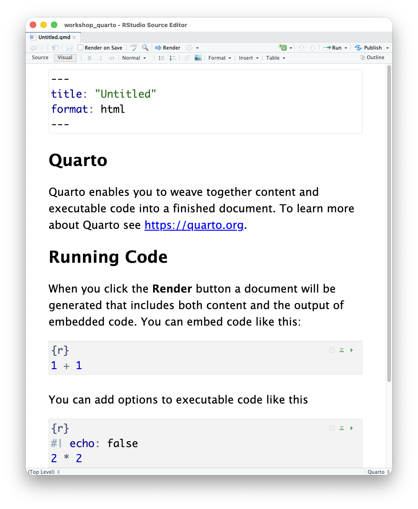{width="100%"}

:::
::::

## Quarto Document | Quarto vs R Markdown

For those who already use R Markdown, the key differences<sup>*</sup> are

| | R Markdown | Quarto |
|:--|:--|:--|
| File extension | `.Rmd` | `.qmd` |
| Output format in YAML | `output: pdf_document` | `format: pdf` |
| Chunk options | `{r, echo=FALSE}` | <code>#&#124; echo: false</code> |
| Option names | `fig.cap`, `out.width` | `fig-cap`, `out-width` |
| Inline code | <code>&#96;r 1+1&#96;</code> | <code>&#96;{r} 1+1&#96;</code> |
| Cross-references | `\autoref{}`, `bookdown` | `@fig-`, `@tbl-`, built in |
| Render | `Knit` button | `Render` button |
| Languages | mostly R | R, Python, Julia, Observable |

<br>

<span class="footnote">The old syntax continues to work in most cases, but the new one is recommended.</span>

## Quarto Document | Notes

- Behind the scenes, each `.qmd` file is rendered in its own, new R session
  - the code therefore needs to stand alone, for reproducibility reasons
  - e.g., if you load a package in the Console, it will not be available to a given `.qmd` file

- Quarto can produce more than research papers,<sup>*</sup> including
  - presentations --- e.g., these slides
  - websites, blogs, and books
  - dashboards

<span class="footnote">* Here we will focus on research papers only. See the <a href="https://quarto.org/docs/guide/" target="_blank">Quarto Guide</a> for the others.</span>


## Quarto Document | Exercises 1 -- 2 {.action-slide}


1. Source and visual modes
    - in your new document, switch to `Visual` mode, and make a word italics, using the formatting toolbar
    - switch back to `Source` mode, and observe how the italic word is written in Markdown
    - delete the new document, and all related files
        - e.g., in the `Files` tab, the `.qmd` and `.html` files, and the folder with the same name, ending in `_files`

2. Rendering the manuscript
    - open `manuscript/journals.qmd`, and render it
    - observe that the output is plain text, without a title or formatting
        - the YAML and the Markdown syntax are missing --- adding them is what we will do next

# Part 3. Setting Metadata {#part3 .part-slide background-color="#447099"}

::: {.slide-link}
[Back to the contents slide](#contents-slide).
:::

## YAML | Overview {#yaml-overview}

:::: {.columns}
::: {.column width="55%"}

`.qmd` documents start<sup>*</sup> with YAML

- includes the metadata variables
  - e.g., title, output format

- written between a pair of three hyphens [-]{.yellow-h}

:::

::: {.column width="45%"}

```{.yaml}
---
title:
format:
---
```

:::
::::

<span class="footnote">* It is conventionally placed at the very beginning of the document, although Quarto also recognises it elsewhere, if preceded by a blank line.</span>

## YAML | Variables

:::: {.columns}
::: {.column width="55%"}

- `title` and `format` are the basic variables of YAML
  - variable names are typed in lower case, followed by a colon [:]{.yellow-h}
  - the list of available variables depends on the output format
      - the <a href="https://quarto.org/docs/reference/" target="_blank">Quarto Reference</a> lists them all, for each format
      - the <a href="https://rstudio.github.io/cheatsheets/quarto.pdf" target="_blank">Quarto cheat sheet</a> provides a helpful summary

- Typical YAML variables for a research paper are on the right

:::

::: {.column width="45%"}

```{.yaml}
---
title:
author:
date:
bibliography:
csl:
format:
---
```

:::
::::

## YAML | Variable Values {#yaml-variable-values}

:::: {.columns}
::: {.column width="55%"}
Variables can take

- [strings]{.yellow-h}, e.g., a title
- [lists]{.yellow-h}, one item per line, each starting with a dash
  - e.g., several authors
  - for one author, a string works as well, e.g., `author: Jane Doe`
- pre-defined [options]{.yellow-h}, e.g., an output format
:::

::: {.column width="45%"}
```{.yaml code-line-numbers="2|3-5|6"}
---
title: "Journals: A Mock Paper"
author:
  - Jane Doe
  - John Roe
format: pdf
---
```
:::
::::


## YAML | Output Formats

:::: {.columns}
::: {.column width="55%"}

Documents as output formats include

- [HTML]{.yellow-h}

```{.yaml code-line-numbers="3"}
---
title: "Journals: A Mock Paper"
format: html
---
```

:::

::: {.column width="45%"}

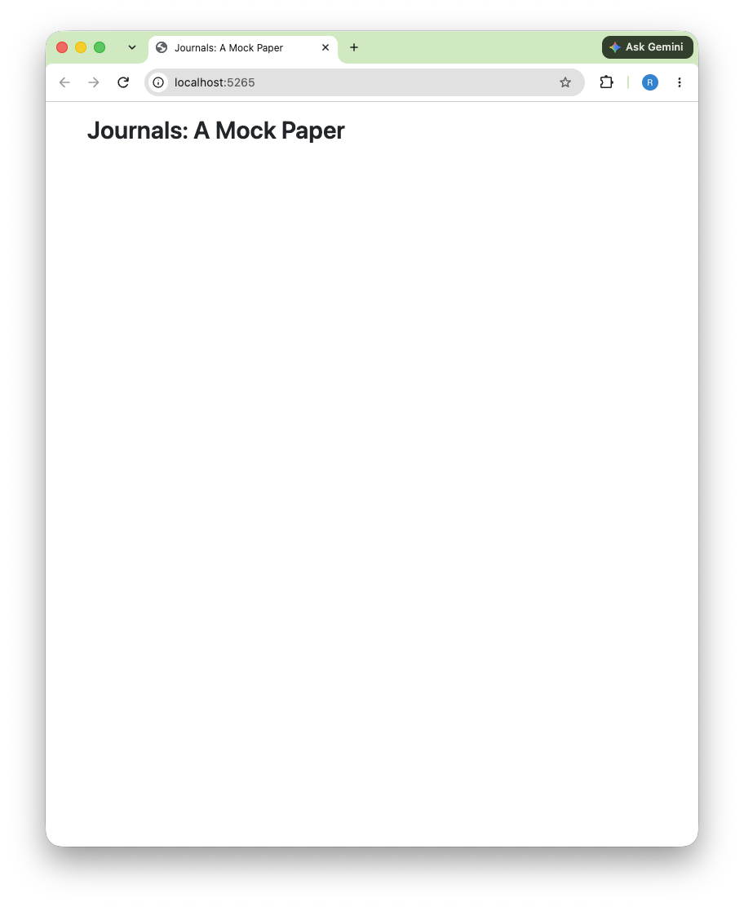{width="100%"}

:::
::::

## YAML | Output Formats (2)

:::: {.columns}
::: {.column width="55%"}

Documents as output formats include

- HTML
- [PDF]{.yellow-h}

```{.yaml code-line-numbers="3"}
---
title: "Journals: A Mock Paper"
format: pdf
---
```

:::

::: {.column width="45%"}

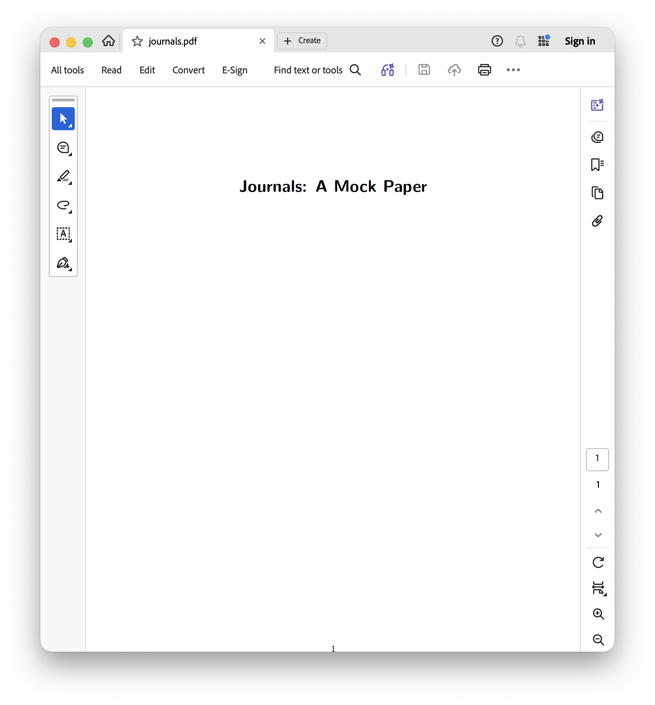{width="100%"}

:::
::::

## YAML | Output Formats (3)

:::: {.columns}
::: {.column width="55%"}

Documents as output formats include

- HTML
- PDF
- [Word]{.yellow-h}

```{.yaml code-line-numbers="3"}
---
title: "Journals: A Mock Paper"
format: docx
---
```

:::

::: {.column width="45%"}

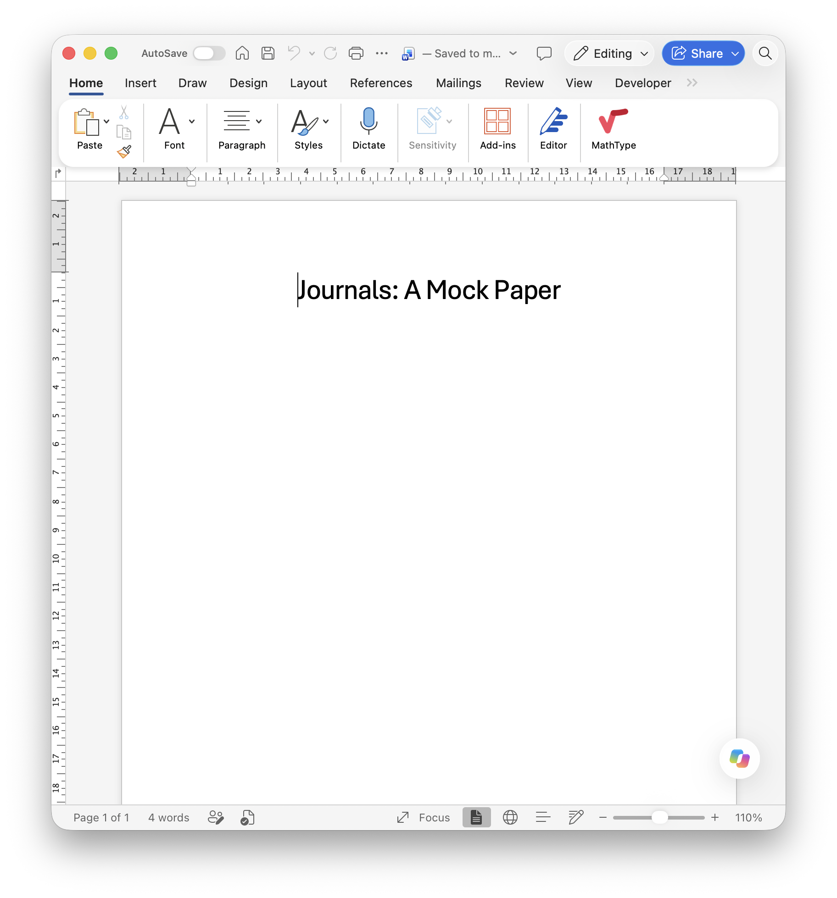{width="100%"}

:::
::::

## YAML | Output Formats | Overview {#output-formats-overview}

:::: {.columns}
::: {.column width="50%"}

Documents

- `html`
- `pdf`<sup>*</sup>
- `docx`
- `odt`
- `typst`<sup>**</sup>
- `epub`
- `gfm`

:::

::: {.column width="50%"}

Presentations

- `revealjs`
- `pptx`
- `beamer`

:::
::::

<br>

<span class="footnote">* This workshop focuses on PDF and Word outputs, which are most common for research papers, but most of what we cover applies to HTML as well. Different formats have slightly different options --- see the <a href="https://quarto.org/docs/reference/" target="_blank">Quarto Reference</a>.<br>** Typst is a newer alternative to LaTeX for PDF outputs, and still developing. It is faster and requires no installation, but is less flexible for now.</span>


## YAML | Strings

:::: {.columns}
::: {.column width="55%"}

Strings with special characters, such as colon, require quotation marks --- single [']{.yellow-h} or double ["]{.yellow-h}

```{.yaml code-line-numbers="2|3"}
---
title: "Journals: A Mock Paper"
subtitle: Prepared for a Quarto Workshop
author: Jane Doe
date: 4 March 2026
date-format: "D MMMM YYYY"
format: pdf
---
```

Quotation marks are optional for strings without special characters


:::

::: {.column width="45%"}

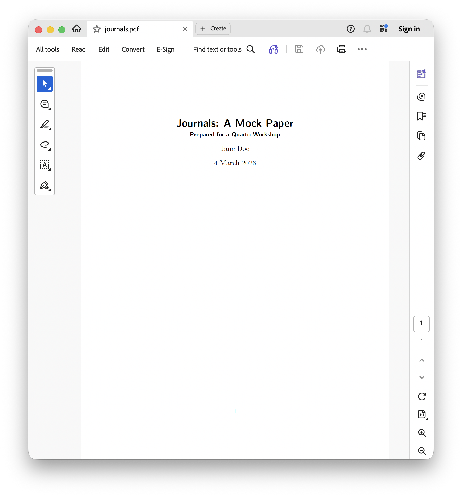{width="100%"}

:::
::::

## YAML | Strings | Dates

- Quarto recognises dates, and formats them in a standard way
  - `date: 4 March 2026` becomes [2026-03-04]{.inline-output} by default
  - `date-format` defines how they should appear instead
      - e.g., `date-format: "D MMMM YYYY"` turns it into [4 March 2026]{.inline-output}

- Quarto offers a few special values for dates
  - `date: today` becomes the date on which the document is rendered
  - `date: last-modified` becomes the date on which the file was last modified

- Code can be used as well

```{.yaml}
date: "First version: 4 March 2026. This version: `r format(Sys.Date(), '%d %B %Y')`."
```

<br>

<span class="footnote">See <a href="https://quarto.org/docs/reference/dates.html" target="_blank">quarto.org/docs/reference/dates.html</a> for the date formats.</span>

## YAML | Strings | Notes

:::: {.columns}
::: {.column width="55%"}

The `thanks` variable adds a note to the title

```{.yaml code-line-numbers="4"}
---
title: "Journals: A Mock Paper"
subtitle: Prepared for a Quarto Workshop
thanks: "Preliminary draft. Please do not cite or circulate without permission from the author."
author: Jane Doe
date: 4 March 2026
date-format: "D MMMM YYYY"
format: pdf
---
```

<br>

Notice that

- the note is a footnote, with a symbol
- it works in [PDF outputs only]{.yellow-h}

:::

::: {.column width="45%"}

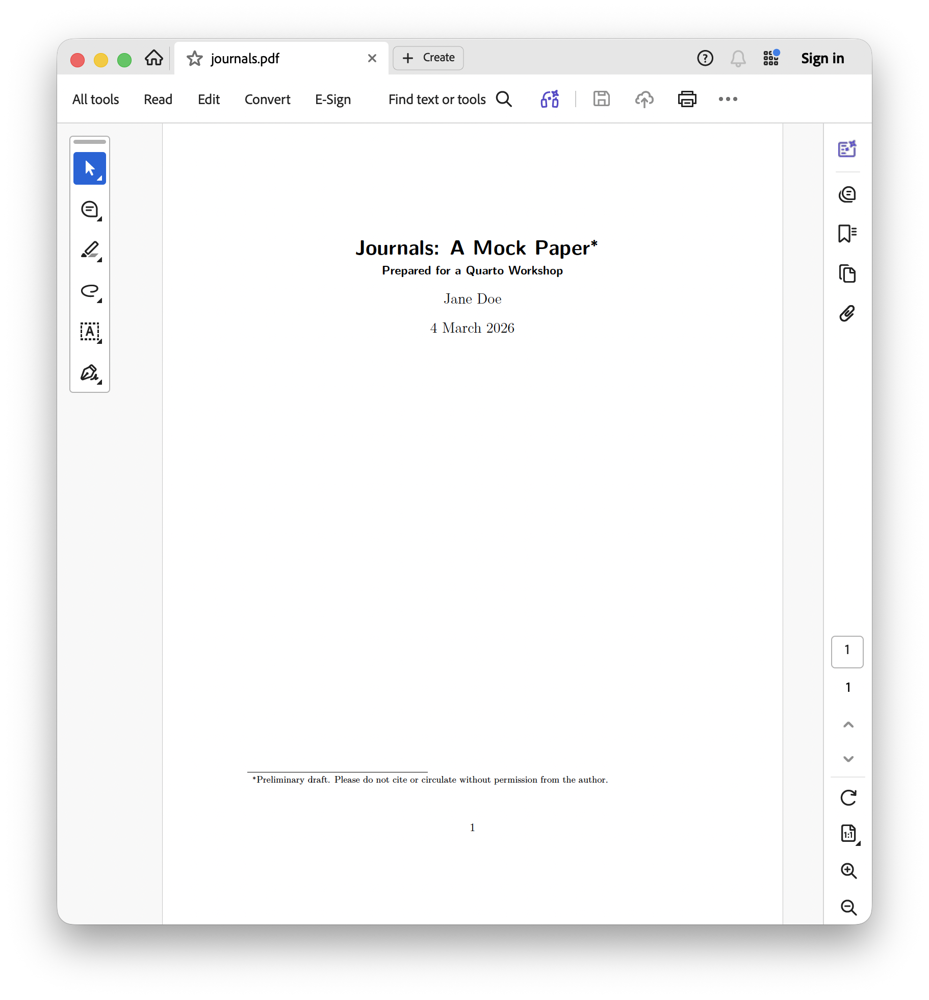{width="100%"}

:::
::::

## YAML | Strings | Footnotes {#footnote-headers}

:::: {.columns}
::: {.column width="55%"}
The syntax `^[footnotes go here]` adds footnotes to any string --- in PDF and Word outputs

```{.yaml code-line-numbers="2,5"}
---
title: "Journals: A Mock Paper^[Preliminary draft.]"
subtitle: Prepared for a Quarto Workshop
author: "Jane Doe^[Department of Science, Example University.]"
date: 4 March 2026
date-format: "D MMMM YYYY"
format: pdf
---
```

:::

::: {.column width="45%"}

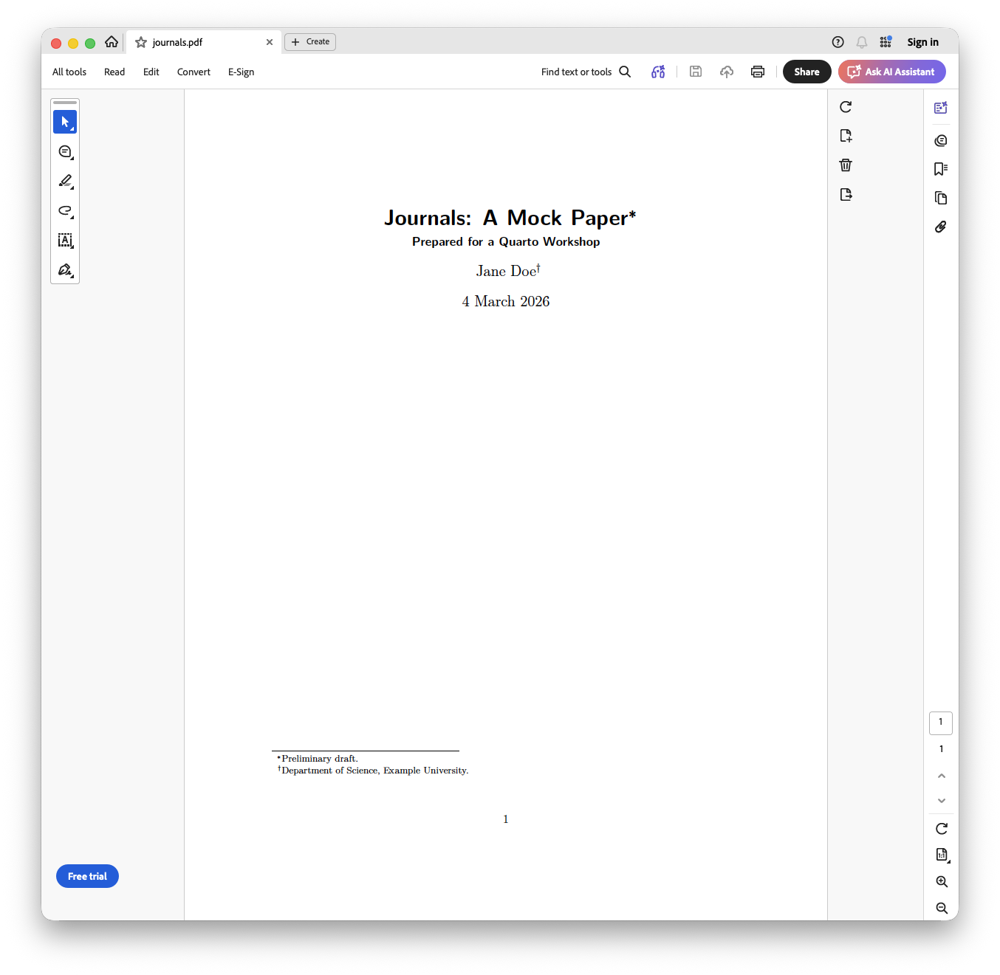{width="100%"}
:::
::::

## YAML | Abstract

:::: {.columns}
::: {.column width="55%"}

The `abstract` variable takes a longer string

```{.yaml code-line-numbers="6-12"}
---
title: "Journals: A Mock Paper"
author: Jane Doe
date: 4 March 2026
date-format: "D MMMM YYYY"
abstract: |
  Why do some academic journals rank
  higher than others on Google Scholar?
  This paper introduces a new dataset on
  the rankings of fictitious journals, and
  uses it to explore what predicts their
  impact.
format: pdf
---
```

Notice that

- the vertical line [|]{.yellow-h} allows for multiple lines
    - which must be indented
- the default PDF template prints the abstract without a heading

:::

::: {.column width="45%"}

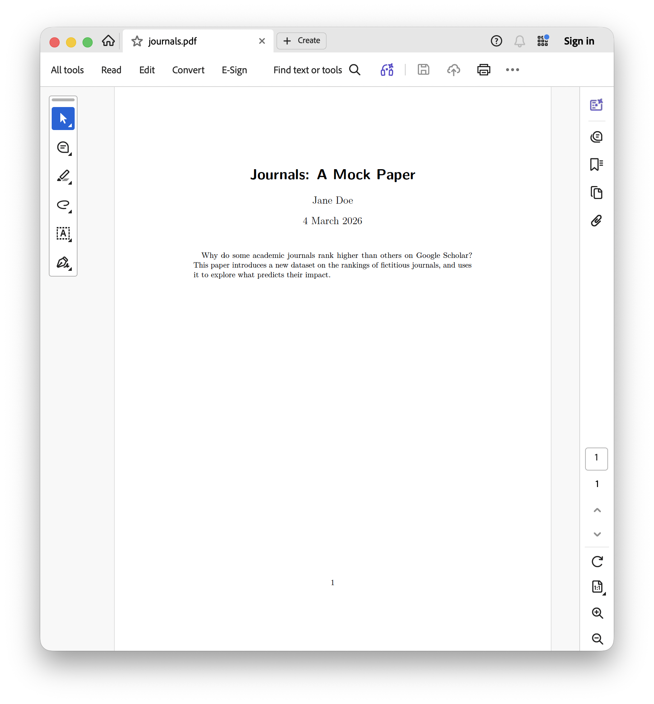{width="100%"}

:::
::::

## YAML | External Files

:::: {.columns}
::: {.column width="55%"}

The `bibliography` and `csl` variables take strings for file names

- `bibliography` points to a `.bib` file
  - a database of references, one entry for each, with details such as authors, year, and title

- `csl` points to a `.csl` file
  - a citation style, defining how citations and the list of references look --- e.g., APA

:::

::: {.column width="45%"}

```{.yaml code-line-numbers="6-7"}
---
title: "Journals: A Mock Paper"
author: Jane Doe
date: 4 March 2026
date-format: "D MMMM YYYY"
bibliography: references.bib
csl: apa_7th.csl
format: pdf
---
```

:::
::::

## YAML | External Files | Locations

:::: {.columns}
::: {.column width="55%"}

The strings for external files indicate [where the files are]{.yellow-h}, and how they are named

- Locations are [relative to the `.qmd` file]{.yellow-h}
  - `..` means one level up

- Absolute paths should be avoided
  - they do not work on another computer, including your own new computer

<br>

Notice that, as in R scripts, `#` starts a comment in YAML

- Quarto ignores the rest of the line

:::

::: {.column width="45%"}

```{.yaml}
# the same folder
bibliography: ref_library.bib

# a folder one level down
bibliography: "references/ref_library.bib"

# a folder two levels up
csl: "../../styles/chicago.csl"

# an absolute path --- avoid
csl: "C:/Users/resul/Dropbox/chicago.csl"
```

:::
::::


## YAML | Options and Sub-Options

:::: {.columns}
::: {.column width="55%"}

Options can have sub-options

```{.yaml code-line-numbers="6-11"}
---
title: "Journals: A Mock Paper"
author: Jane Doe
date: 4 March 2026
date-format: "D MMMM YYYY"
format:
  pdf:
    number-sections: true
    toc: true
    fontsize: 12pt
    linestretch: 1.5
---
```

:::

::: {.column width="45%"}

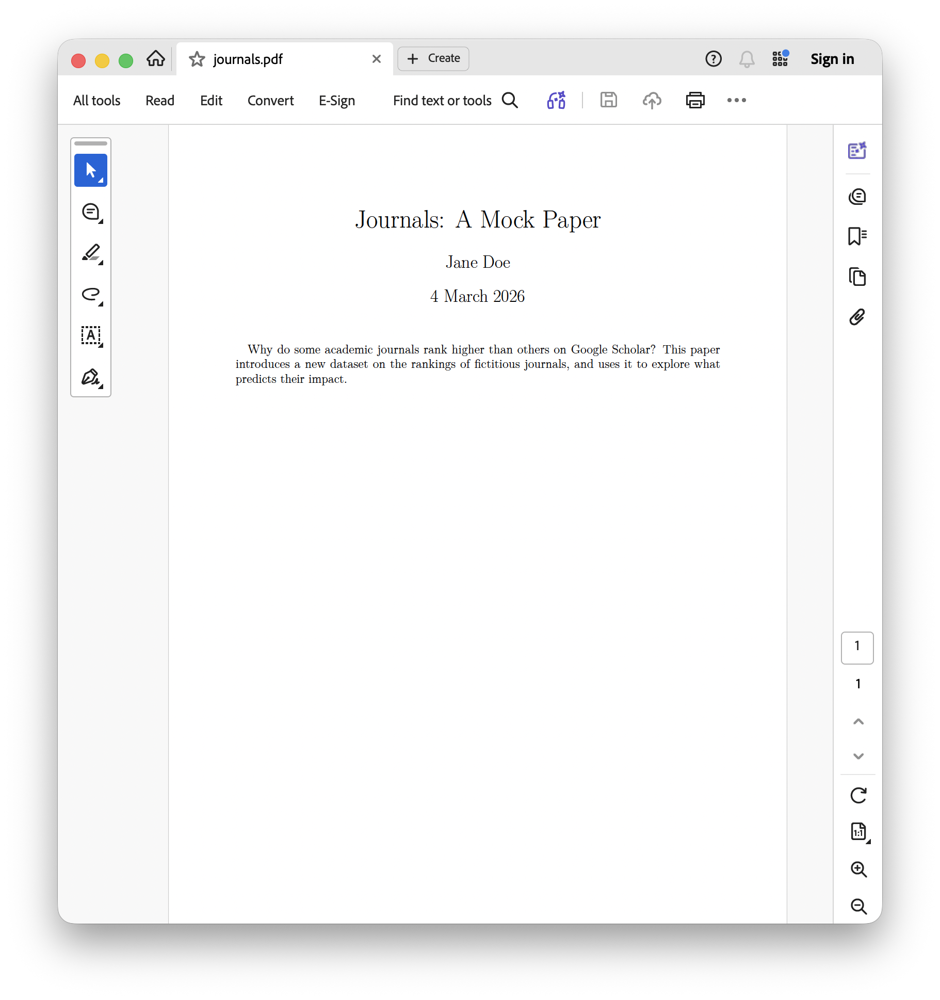{width="100%"}

:::
::::

## YAML | Options and Sub-Options | Syntax

:::: {.columns}
::: {.column width="55%"}

- An option that holds sub-options ends with a colon only
  - e.g., `format:` and `pdf:`

- The last level has a colon, followed by a space and an optional value
  - e.g., `fontsize: 12pt`

:::

::: {.column width="45%"}

```{.yaml code-line-numbers="|1-2|3-4"}
format:
  pdf:
    fontsize: 12pt
    linestretch: 1.5
```

:::
::::


:::: {.columns}
::: {.column width="55%"}


- Each level is indented [one step further]{.yellow-h}
  - consistently, typically with two spaces
  - tabs are not allowed in YAML

:::

::: {.column width="45%"}

```
# with spaces shown as dots
format:
··pdf:
····fontsize: 12pt
····linestretch: 1.5
```

:::
::::


## YAML | Options and Sub-Options | Multiple Formats

:::: {.columns}
::: {.column width="55%"}

The same document can be rendered into multiple formats

- List all formats under `format`

- The `Render` button renders the [first format]{.yellow-h} listed --- here, `pdf`
  - its drop-down menu lists the others, e.g., `Render MS Word`

:::

::: {.column width="45%"}

```{.yaml code-line-numbers="|3-6|4"}
---
title: "Journals: A Mock Paper"
format:
  pdf: default
  docx: default
  html: default
---
```

:::
::::

## YAML | Options and Sub-Options | Format Scope

:::: {.columns}
::: {.column width="55%"}

Options can be set for all formats, or for one format only

- at the top level, outside `format`, they apply to [all formats]{.yellow-h}
- as sub-options of a format, they apply to [that format only]{.yellow-h}

<br>

Here,

- all outputs will have numbered sections
- only the PDF output will have 1.5 line spacing
- only the Word output will have a table of contents
- the HTML output will have no other changes

:::

::: {.column width="45%"}

```{.yaml code-line-numbers="|3|6|8|9"}
---
title: "Journals: A Mock Paper"
number-sections: true
format:
  pdf:
    linestretch: 1.5
  docx:
    toc: true
  html: default
---
```

:::
::::

## YAML | Some Further Settings | PDF {#yaml-further-settings}

:::: {.columns}
::: {.column width="50%"}

- `fontsize`
  - e.g., `11pt`, `12pt`

- `linestretch`
  - line spacing; e.g., `1.5`, `2`

- `geometry`
  - margins; e.g., `margin=1in`

- `papersize`
  - e.g., `a4`, `letter`

:::

::: {.column width="50%"}

- `number-sections`
  - `true` or `false`

- `toc`
  - table of contents; `true` or `false`

- `linkcolor`, `urlcolor`, `citecolor`
  - e.g., `blue`, `red`

- `link-citations`
  - `true` makes citations link to the list of references

:::
::::

<br>

<span class="footnote">The full list is available at <a href="https://quarto.org/docs/reference/formats/pdf.html" target="_blank">quarto.org/docs/reference/formats/pdf.html</a>.</span>

## YAML | Errors

:::: {.columns}
::: {.column width="55%"}

- YAML is strict about its syntax
  - a missing colon, a misplaced space, or an unquoted special character can stop rendering

- Quarto checks YAML before rendering, and reports problems
  - e.g., the error on the right is due to `date` being indented, as if it was a sub-option of `author`

- Read the error messages
  - they often point to the line and column of the problem
  - if unclear, search for them online, or ask a generative AI tool

:::

::: {.column width="45%"}

```{.yaml code-line-numbers="4"}
---
title: "Journals: A Mock Paper"
author: Jane Doe
  date: 4 March 2026
format: pdf
---
```

::: {.output-box}
ERROR: YAMLException: bad indentation of a mapping entry (4:7)
:::

:::
::::

## YAML | Bugs


- Not all problems are your errors
  - Quarto is evolving, and sometimes it has bugs

- If you suspect a bug
  - update Quarto, and check whether it persists
  - search the existing issues at <a href="https://github.com/quarto-dev/quarto-cli/issues" target="_blank">github.com/quarto-dev/quarto-cli/issues</a>
  - if it is new, report it, following the instructions on the bug report form on GitHub


## YAML | Bugs | Example

:::: {.columns}
::: {.column width="55%"}

In PDF outputs with numbered sections, a footnote in the title turns all headers into plain text

```{.yaml}
---
title: "A Title^[A footnote.]"
number-sections: true
format: pdf
---

# Introduction
```

<br>

Note that

  - I <a href="https://github.com/quarto-dev/quarto-cli/issues/14982" target="_blank">reported this on GitHub</a>, and it has been fixed
  - the fix will be part of a future version of Quarto
:::

::: {.column width="45%"}

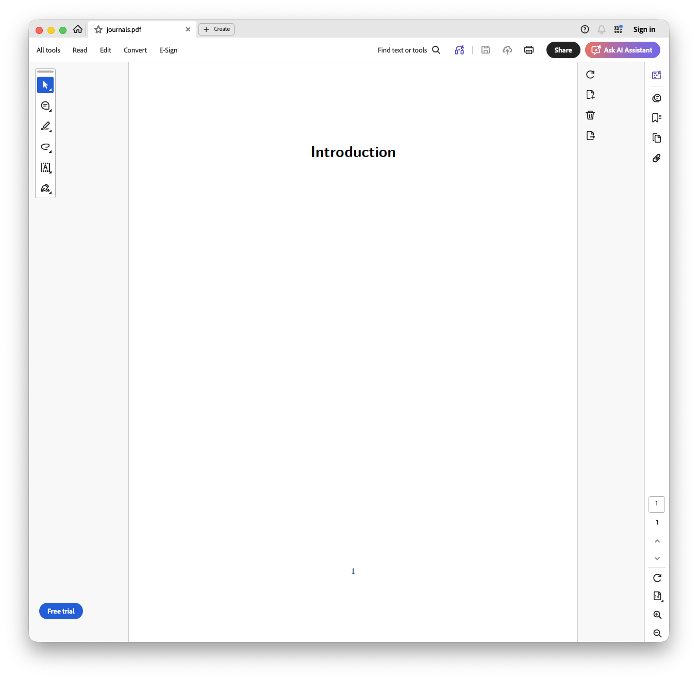{width="100%"}

:::
::::

## YAML | Exercises 3 -- 6 {.action-slide #exercises3_6}


3. Open `journals.qmd` and fill in the YAML variables for the mock paper
    - take cues from `reproduce_this.pdf` and/or the slides
    - use `thanks` for the note, including the author's department, email, and website
    - set the output format to PDF

4. Complete the YAML of the mock paper with its layout settings
    - numbered sections, with `number-sections`
    - 1.5 line spacing, with `linestretch`, for the PDF output

5. Add and set a completely new variable not covered so far
    - see, for example, the Quarto cheat sheet or the <a href="https://quarto.org/docs/reference/formats/pdf.html" target="_blank">Quarto Reference</a>

6. Render `journals.qmd` into Word
    - observe the outcomes, and notice the differences with PDF
    - revert back to PDF for future exercises

# Part 4. Writing Text {#part4 .part-slide background-color="#447099"}

::: {.slide-link}
[Back to the contents slide](#contents-slide).
:::

## Syntax | Overview

- There are not one, but several different versions of Markdown
  - e.g., <a href="https://pandoc.org/MANUAL.html#pandocs-markdown" target="_blank">Pandoc</a>, <a href="https://commonmark.org/" target="_blank">CommonMark</a>, <a href="https://github.github.com/gfm/" target="_blank">GitHub Flavored Markdown</a>
  - each might implement the same things (e.g., citations) slightly differently, and each might offer unique functionalities

- Quarto follows the syntax in Pandoc's Markdown [@pandoc]
  - plus a few extensions of its own, e.g., for cross-references and callouts
  - for a complete overview, see <a href="https://quarto.org/docs/authoring/markdown-basics.html" target="_blank">quarto.org/docs/authoring/markdown-basics.html</a>
  - for a useful summary, see the <a href="https://rstudio.github.io/cheatsheets/quarto.pdf" target="_blank">Quarto cheat sheet</a>

- If you have used R Markdown before, the syntax for text is the same

## Syntax | Lines

Multiple spaces on a given line are reduced to one

```{.markdown}
This is a sentence followed by four spaces.    This is another sentence on the same line.
```

::: {.output-box}
This is a sentence followed by four spaces.    This is another sentence on the same line.
:::

<br>

Line endings with fewer than two spaces are ignored

```{.markdown}
This is a sentence followed by one space.
This is another sentence on a new line.
```

::: {.output-box}
This is a sentence followed by one space.
This is another sentence on a new line.
:::

## Syntax | Hard Breaks

Two or more spaces at the end of a line introduce a hard break, forcing a new line

```{.markdown}
This is a sentence followed by two spaces.  
This is another sentence on a new line.
```

::: {.output-box}
This is a sentence followed by two spaces.  
This is another sentence on a new line.
:::

<br>

A backslash [\\]{.yellow-h} does the same, and is easier to see, so it is less likely to be lost by accident

```{.markdown}
This is a sentence followed by a backslash.\
This is another sentence on a new line.
```

::: {.output-box}
This is a sentence followed by a backslash.\
This is another sentence on a new line.
:::

## Syntax | Line Blocks

Spaces on lines that start with a vertical line [|]{.yellow-h} are kept

```{.markdown}
| a one-space indent
|     a five-space indent
|          a ten-space indent
```

::: {.output-box}
| a one-space indent
|     a five-space indent
|          a ten-space indent
:::

## Syntax | Block Quotes

Lines starting with the greater-than sign [>]{.yellow-h} introduce block quotes<sup>*</sup>

```{.markdown}
> In God, we trust. All others must bring data.
>
> --- Anonymous
```

::: {.output-box}
> In God, we trust. All others must bring data.
>
> --- Anonymous
:::

<br>

<span class="footnote">* Notice that three hyphens grouped together introduce an em-dash. Dashes are covered [later on](#dashes) in this part.</span>

## Syntax | Paragraphs

One or more<sup>*</sup> blank lines introduce a new paragraph

```{.markdown}
This is the first sentence of a paragraph as it is preceded by a blank line. This is the
second sentence of that paragraph, which is followed by a blank line.

This is the first sentence of a new paragraph as it is preceded by a blank line. This is
the second sentence of that paragraph, which is followed by a blank line.
```

::: {.output-box}
This is the first sentence of a paragraph as it is preceded by a blank line. This is the
second sentence of that paragraph, which is followed by a blank line.

This is the first sentence of a *new paragraph* as it is preceded by a blank line. This is
the second sentence of that paragraph, which is followed by a blank line.
:::

<br>

<span class="footnote">* Multiple blank lines between paragraphs reduce to one.</span>

## Syntax | Comments

Text with the syntax `<!-- comments -->` is omitted from output

```{.markdown}
<!-- This paragraph needs re-writing -->
This is the first sentence of a paragraph as it is preceded by a blank line. This is the
second sentence of that paragraph, which is followed by a blank line.

This is the first sentence of a new paragraph <!-- I've removed italics --> as it is
preceded by a blank line. This is the second sentence of that paragraph.
```

::: {.output-box}
This is the first sentence of a paragraph as it is preceded by a blank line. This is the
second sentence of that paragraph, which is followed by a blank line.

This is the first sentence of a new paragraph as it is
preceded by a blank line. This is the second sentence of that paragraph.
:::

<span class="footnote">Keyboard shortcut: `Ctrl + Shift + C` on Windows, `Cmd + Shift + C` on Mac, comments out the selected lines.</span>

## Syntax | Exercises 7 -- 8 {.action-slide}


7. Hard breaks
    - see `reproduce_this.pdf`, marked `Ex. 7` in the margin
    - apply in `journals.qmd`: paragraph 1

8. Line blocks and block quotes
    - see `reproduce_this.pdf`, marked `Ex. 8` in the margin
    - apply in `journals.qmd`: block quote, between paragraphs 1 and 2; hypothesis 1, between paragraphs 14 and 15; hypothesis 2, between paragraphs 16 and 17

## Syntax | Headers

The number sign [#]{.yellow-h} introduces headers; lower levels are created with additional signs

:::: {.columns}
::: {.column width="50%"}

`# Introduction` becomes

::: {.output-box}
<p style="font-size:1.8em; font-weight:bold; margin:0;">Introduction</p>
:::

`## Introduction` becomes

::: {.output-box}
<p style="font-size:1.5em; font-weight:bold; margin:0;">Introduction</p>
:::

`### Introduction` becomes

::: {.output-box}
<p style="font-size:1.25em; font-weight:bold; margin:0;">Introduction</p>
:::

:::

::: {.column width="50%"}

<br>

Notice that

- there must be a space after the number signs
- and a blank line before the header
- numbers can be added automatically
    - with `number-sections: true` in YAML
- individual headers can be left unnumbered
    - e.g., `# Abstract {.unnumbered}`

:::
::::

## Syntax | Emphases

A pair of single asterisks [*]{.yellow-h} or underscores [_]{.yellow-h} introduces italics

`*italics*` becomes [*italics*]{.inline-output}

`_italics_` becomes [*italics*]{.inline-output} as well

<br>

A pair of double asterisks or underscores introduces bold

`**bold**` becomes [**bold**]{.inline-output}

`__bold__` becomes [**bold**]{.inline-output} as well

<br>

These two rules can be combined

`***bolditalics***` becomes [***bolditalics***]{.inline-output}

`**_bolditalics_**` becomes [***bolditalics***]{.inline-output} as well

## Syntax | Strikethrough and Other Spans

A pair of double tildes [~~]{.yellow-h} introduces strikethrough

`~~strikethrough~~` becomes [~~strikethrough~~]{.inline-output}

<br>

Square brackets followed by a class in curly brackets introduce further styles<sup>*</sup>

`[underline]{.underline}` becomes [[underline]{.underline}]{.inline-output}

`[small caps]{.smallcaps}` becomes [[Small Caps]{.smallcaps}]{.inline-output}

`[highlighted]{.mark}` becomes [highlighted]{.inline-output style="background-color:#ffff88 !important;"}

<br>

<span class="footnote">* These are called spans. They work in HTML, PDF, and Word outputs. Some other classes are output specific.</span>

## Syntax | Exercises 9 -- 10 {.action-slide}


9. Headers
    - see `reproduce_this.pdf`, marked `Ex. 9` in the margin
        - 10 headers, Abstract to References --- the Appendix comes later, in [Exercise 36](#exercises-36-37)
    - apply in `journals.qmd`
    - keep the Abstract and References unnumbered, as the other headers are numbered automatically since [Exercise 4](#exercises3_6)
    - if your headers turn into plain text in the PDF, see [this slide](#footnote-headers)

10. Emphases
    - see `reproduce_this.pdf`, marked `Ex. 10` in the margin
        - bold and italics
    - apply in `journals.qmd`: paragraph 2

## Syntax | Links | Internal^\*^ {#internal-links}

You can link text to existing headers in the same document

`[Introduction](#introduction)` becomes [[Introduction](#internal-links)]{.inline-output}, and a click takes the reader to the section with the header `# Introduction`

<br>

Quarto creates these identifiers from headers automatically --- in lower case, with hyphens instead of spaces

`[Literature Review](#literature-review)` becomes [[Literature Review](#internal-links)]{.inline-output}

<br>

Alternatively, you can give headers your own identifiers

```{.markdown}
# Literature Review {#litreview}

As discussed in the [literature review](#litreview), ...
```

<br>

<span class="footnote">* Quarto offers a more powerful alternative for sections, as well as for figures, tables, and equations: cross-references, covered in [Part 7](#cross-references).</span>

## Syntax | Links | External

You can link text to URLs

`[visit my website](https://resulumit.com/)` becomes [[visit my website](https://resulumit.com/)]{.inline-output}

`[https://resulumit.com](https://resulumit.com/)` becomes [[https://resulumit.com](https://resulumit.com/)]{.inline-output}

`<https://resulumit.com>` becomes [<https://resulumit.com>]{.inline-output} as well

<br>

You can also link text to an email address

`[email me](mailto:jane.doe@example.edu)`<sup>*</sup> becomes [[email me](mailto:jane.doe@example.edu)]{.inline-output}

`<jane.doe@example.edu>` becomes [<jane.doe@example.edu>]{.inline-output}

<br>

<span class="footnote">* Notice the prefix [mailto:]{.yellow-h} in the syntax.</span>

## Syntax | Exercises 11 -- 12 {.action-slide}


11. Links --- internal
    - see `reproduce_this.pdf`, marked `Ex. 11` in the margin
        - the link to the Literature Review section
    - apply in `journals.qmd`: paragraph 4

12. Links --- external
    - see `reproduce_this.pdf`, marked `Ex. 12` in the margin
        - email and website links in the note on the title
    - apply in `journals.qmd`: `thanks` in YAML

## Syntax | Equations

Inline equations go between a pair of single dollar signs [\$]{.yellow-h} --- with no space between the signs and the equation itself

`$E = mc^{2}$` becomes [$E = mc^{2}$]{.inline-output}

<br>

Block equations go between a pair of double dollar signs [\$\$]{.yellow-h}

`$$E = mc^{2}$$` becomes

::: {.output-box}
$$E = mc^{2}$$
:::

<br>

Notice that

- the syntax inside the dollar signs is LaTeX --- see, e.g., <a href="https://en.wikibooks.org/wiki/LaTeX/Mathematics" target="_blank">this guide</a>
- this works in HTML, PDF, and Word outputs --- in Word, equations remain editable

## Syntax | Footnotes | Inline Notes

For inline footnotes, use the `^[footnote]` syntax

`Jane Doe^[Corresponding author.]` becomes [Jane Doe<sup>1</sup>]{.inline-output}

::: {.output-box style="font-size:0.6em;"}
<sup>1</sup> Corresponding author.
:::

<br>

Notice that

- the caret sign [^]{.yellow-h} comes [before]{.yellow-h} the left square bracket [\[]{.yellow-h}
- this syntax works in YAML as well as in text
    - footnotes in YAML get symbols, in text they get numbers

## Syntax | Footnotes | Notes with Identifiers

An alternative is to use the `[^identifier]` syntax, with identifiers defined elsewhere in the same document

```{.markdown}
Dr Doe holds a PhD in rock science.[^defence_date]

[^defence_date]: She defended her thesis in 2017.
```

[Dr Doe holds a PhD in rock science.<sup>1</sup>]{.inline-output}

::: {.output-box style="font-size:0.6em;"}
<sup>1</sup> She defended her thesis in 2017.
:::

<br>

Notice that

- the caret sign comes [after]{.yellow-h} the left square bracket
- this syntax works in text, but not in YAML
- useful for long footnotes, which would otherwise interrupt the flow of the text

## Syntax | Exercises 13 -- 14 {.action-slide}


13. Equations
    - see `reproduce_this.pdf`, marked `Ex. 13` in the margin
    - apply in `journals.qmd`: paragraph 22; block equation, between paragraphs 22 and 23

14. Footnotes
    - see `reproduce_this.pdf`, marked `Ex. 14` in the margin
    - apply in `journals.qmd`: paragraph 3

## Syntax | Lists

Lines starting with an asterisk [*]{.yellow-h}, a plus [+]{.yellow-h}, or a minus [-]{.yellow-h} sign introduce lists

:::: {.columns}
::: {.column width="50%"}

```{.markdown}
- books
- articles
- reports
```

:::

::: {.column width="50%"}

::: {.output-box}
- books
- articles
- reports
:::

:::
::::

Lists can be nested within each other, with indentation

:::: {.columns}
::: {.column width="50%"}

```{.markdown}
- books
- articles
    - published
    - under review
```

:::

::: {.column width="50%"}

::: {.output-box}
- books
- articles
    - published
    - under review
:::

:::
::::

<span class="footnote">Lists need a blank line before them, unless they follow another list item.</span>

## Syntax | Lists | Numbering

List items can be numbered

:::: {.columns}
::: {.column width="50%"}

```{.markdown}
1. books
2. articles
    - published
    - under review
        - revised and resubmitted
```

:::

::: {.column width="50%"}

::: {.output-box}
1. books
2. articles
    - published
    - under review
        - revised and resubmitted
:::

:::
::::

<br>

Note that

- the numbers in the source do not need to be in order
    - e.g., `1.`, `1.`, `1.` would still become 1, 2, 3
- the first number determines where the list starts

## Syntax | Dashes {#dashes}

Two hyphens grouped together introduce an en-dash

`--` becomes [--]{.inline-output}

<br>

Three hyphens grouped together introduce an em-dash

`---` becomes [---]{.inline-output}

## Syntax | Subscripts and Superscripts

A pair of tildes introduces subscript

`CO~2~` becomes [CO~2~]{.inline-output}

<br>

A pair of carets introduces superscript

`R^2^` becomes [R^2^]{.inline-output}

<br>

Note that

- the syntax for subscripts and superscripts (Markdown) is different than the one for equations (LaTeX)
    - e.g., `R^2^` versus `$R^{2}$`
    
## Syntax | Divs and Callouts

Three or more colons `<span class="yellow-h">:::</span>`{=html} introduce divs, which group content and give it a style

```{.markdown}
::: {.callout-note}
This dataset is fabricated, for demonstration purposes only.
:::
```

::: {.callout-note}
This dataset is fabricated, for demonstration purposes only.
:::

<br>

- Divs are also used for, e.g., multi-column layouts, the list of references, and content for specific formats
    - the latter two covered in Parts [5](#reference-list-placement) and [7](#content-by-format)
    
- Callouts come in five types
    - `note`, `tip`, `important`, `warning`, and `caution`

## Syntax | Page Breaks {#page-breaks}

The `{}` shortcode<sup>*</sup> introduces a page break

```{.markdown}
This is the last sentence of the main text.

{}

# Appendix
```

<br>

Note that

- this works in PDF and Word outputs alike
    - as opposed to the LaTeX command `\newpage`, which works in PDF outputs only
- in HTML outputs, it is ignored

<br>

<span class="footnote">* Shortcodes are special Quarto commands, written between <code>&#123;&#123;&lt;</code> and <code>&gt;&#125;&#125;</code>. Others include, e.g., <code>&#123;&#123;&lt; lipsum &gt;&#125;&#125;</code> for placeholder text.</span>

## Syntax | Exercises 15 -- 17 {.action-slide}


15. Lists
    - see `reproduce_this.pdf`, marked `Ex. 15` in the margin
    - apply in `journals.qmd`: list, between paragraphs 10 and 11

16. Dashes
    - see `reproduce_this.pdf`, marked `Ex. 16` in the margin
    - apply in `journals.qmd`: paragraph 6

17. Subscripts and superscripts
    - see `reproduce_this.pdf`, marked `Ex. 17` in the margin
    - apply in `journals.qmd`: paragraph 5

# Part 5. Managing References {#part5 .part-slide background-color="#447099"}

::: {.slide-link}
[Back to the contents slide](#contents-slide).
:::

## References | Bibliography Database

:::: {.columns}
::: {.column width="55%"}

- References are typically defined in `.bib` files<sup>*</sup>
  - they follow the BibTeX format

- `.bib` files are specified with the `bibliography` variable in YAML
  - multiple files can be listed, e.g., `[references.bib, packages.bib]`

- Each citation needs a matching entry in the `.bib` file
  - but only cited entries appear in the list of references
  
<span class="footnote">* Other formats are possible too, e.g., CSL JSON.</span>

:::

::: {.column width="45%"}

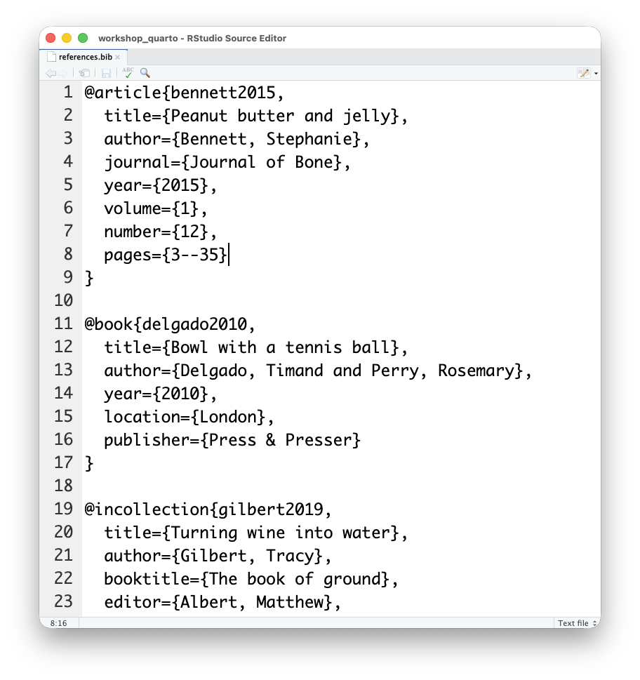{width="100%"}

:::
::::

## References | Bibliography Database | Entries

:::: {.columns}
::: {.column width="45%"}

- A BibTeX entry consists of three elements
  - a [type]{.yellow-h}
      - e.g., `@article`, `@book`
  - a [citation key]{.yellow-h}
      - e.g., `bennett2015`
      - unique within the file
  - a number of [fields]{.yellow-h}
      - e.g., `title`, `author`

- Different fields are available for different reference types
  - some are required, others are optional

:::

::: {.column width="55%"}

<br>

```{.bibtex code-line-numbers="|1|1|2-8|"}
@article{bennett2015,
  title = {Peanut Butter and Jelly},
  author = {Bennett, Sam},
  journal = {Journal of Bone},
  year = {2015},
  volume = {1},
  number = {12},
  pages = {3--35}
}
```

:::
::::

## References | Bibliography Database | Sources

- Create entries manually is possible but inefficient
  - requires knowing the BibTeX format, entry types, fields, and the details of references

- Google Scholar provides BibTeX entries
  - click `Cite -> BibTeX`, copy, paste into the `.bib` file, edit if necessary, and save

- Publishers and journals often provide BibTeX entries on their websites
  - e.g., under `Cite this article` or `Export citation`

- Reference managers can export entries, or keep `.bib` files up to date
  - e.g., Zotero, with the Better BibTeX extension
  - alternatively, RStudio's `Visual` mode can find references, e.g., by DOI, and add them to the `.bib` file --- but recall the warning in [Part 2](#visual-editor)
  
## References | Bibliography Database | Sources | Software

- R provides BibTeX entries for the packages you use
  - e.g., run `toBibtex(citation("modelsummary"))` in the `Console`, copy the entry, and paste it into the `.bib` file

- R can also write entries for several packages into a new `.bib` file

```{.r}
knitr::write_bib(c("ggplot2", "modelsummary"), file = "manuscript/packages.bib")
```

<br>

- GitHub provides BibTeX entries for software hosted there, including Quarto itself
  - click `Cite this repository -> BibTeX` on the repository page

## References | Style

- Reference styles are defined in `.csl` files
  - files for thousands of styles (e.g., APA, Chicago, journal-specific) are available at <a href="https://www.zotero.org/styles" target="_blank">zotero.org/styles</a>

- Quarto looks for a `.csl` file, and for the style therein, to format citations and references
  - `.csl` files are specified with the `csl` variable in YAML
  - if unspecified, Quarto uses the Chicago author-date style

- `.csl` files affect the style only in outputs
  - whichever style is used, the citation syntax in `.qmd` documents remains the same
  - changing the style of a whole manuscript takes a single line in YAML

## References | Citation Syntax | Author-Date Styles<sup>*</sup>

All citation keys take the 'at' sign [@]{.yellow-h}, while square brackets and/or minus signs introduce variation

`[@bennett2015]` becomes [(Bennett, 2015)]{.inline-output}

`@bennett2015` becomes [Bennett (2015)]{.inline-output}

`[-@bennett2015]` becomes [(2015)]{.inline-output}

`[@bennett2015, 35]` becomes [(Bennett, 2015, p. 35)]{.inline-output}

`[@bennett2015, 33-35]` becomes [(Bennett, 2015, pp. 33--35)]{.inline-output}

`[@bennett2015, ch. 1]` becomes [(Bennett, 2015, ch. 1)]{.inline-output}

`[@bennett2015; @gilbert2019]` becomes [(Bennett, 2015; Gilbert, 2019)]{.inline-output}

`[see @bennett2015, for details]` becomes [(see Bennett, 2015, for details)]{.inline-output}

`@bennett2015 [33-35]` becomes [Bennett (2015, pp. 33--35)]{.inline-output}

<span class="footnote">* Specifically, the outputs on this slide are formatted according to the APA 7^th^ edition.</span>

## References | Citation Syntax | Numerical Styles

All citation keys take the 'at' sign [\@]{.yellow-h}

`A clever sentence [@bennett2015].` becomes [A clever sentence \[1\].]{.inline-output} in, e.g., IEEE

`A clever sentence [@bennett2015; @gilbert2019].` becomes [A clever sentence \[1\], \[2\].]{.inline-output}

<br>

Individual styles may or may not use additional information, such as page numbers

`A clever sentence [@bennett2015, 35].` becomes [A clever sentence \[1, p. 35\].]{.inline-output} in IEEE

<br>

Individual styles may or may not be sensitive to variation, such as square brackets

`A clever sentence @bennett2015.` becomes [A clever sentence \[1\].]{.inline-output} in IEEE as well

## References | Reference List

The list of references is placed at the end of the document, without a header

- To add one, either
  - end the `.qmd` document with a header of your choice, e.g., `# References`
  - or set `reference-section-title: References` in YAML, which is never numbered

```{.markdown}
This is the last sentence of an APA style manuscript.

# References
```

::: {.output-box}
This is the last sentence of an APA style manuscript.

<p style="font-size:1.25em; font-weight:bold; margin:0.5em 0 0.3em 0;">References</p>

Bennett, S. (2015). Peanut butter and jelly. *Journal of Bone, 1*(12), 3--35.

Gilbert, T. (2019). Turning wine into water. In M. Albert (Ed.), *The book of ground* (pp. 124--142). Antman.
:::

## References | Reference List | Placement {#reference-list-placement}

To place the list elsewhere --- e.g., before an appendix --- use a div with the identifier `refs`

```{.markdown code-line-numbers="5-6"}
This is the last sentence of an APA style manuscript.

# References

::: {#refs}
:::

# Appendix

This is the first sentence of the appendix.
```

::: {.output-box}
This is the last sentence of an APA style manuscript.

<p style="font-size:1.25em; font-weight:bold; margin:0.5em 0 0.3em 0;">References</p>

Bennett, S. (2015). Peanut butter and jelly. *Journal of Bone, 1*(12), 3--35.

Gilbert, T. (2019). Turning wine into water. In M. Albert (Ed.), *The book of ground* (pp. 124--142). Antman.

<p style="font-size:1.25em; font-weight:bold; margin:0.5em 0 0.3em 0;">Appendix</p>

This is the first sentence of the appendix.
:::

## References | Internal Links {#reference-links}

:::: {.columns}
::: {.column width="55%"}

For links from in-text citations to the reference list, set `link-citations: true` in YAML

- a click on these links takes the reader to the relevant entry in the list

- the `citecolor` variable makes these links visible, in PDF outputs
  - setting this is not necessary for the links to work

:::

::: {.column width="45%"}

```{.yaml code-line-numbers="4-5"}
---
bibliography: references.bib
csl: apa_7th.csl
link-citations: true
citecolor: blue
format: pdf
---
```

:::
::::

## References | Further Options

:::: {.columns}
::: {.column width="55%"}

- `nocite` includes references in the list without citing them in text
  - e.g., two specific entries

:::

::: {.column width="45%"}

```{.yaml code-line-numbers="4-5"}
---
bibliography: references.bib
csl: apa_7th.csl
nocite: |
  @bennett2015, @gilbert2019
format: pdf
---
```

:::
::::

<br>

:::: {.columns}
::: {.column width="55%"}

- `@*` includes all entries in the `.bib` file
  - e.g., for a reading list, or a full bibliography

:::

::: {.column width="45%"}

```{.yaml code-line-numbers="4-5"}
---
bibliography: references.bib
csl: apa_7th.csl
nocite: |
  @*
format: pdf
---
```

:::
::::

## References | Exercises 18 -- 21 {.action-slide}


18. Add an entry to `references.bib` for the following article
    - @hirsch2005, "An index to quantify an individual's scientific research output", with DOI `10.1073/pnas.0507655102`

19. Reproduce the citations and the reference list in the mock paper
    - see `reproduce_this.pdf`, marked `Ex. 19` in the margin
    - apply in `journals.qmd`: paragraphs 7 to 9

20. Change the reference style
    - download the `.csl` file for your favourite style from <a href="https://www.zotero.org/styles" target="_blank">zotero.org/styles</a>
    - put it into the `manuscript` folder
    - update the YAML variable, and render

21. Link the citations to the reference list

## Your Paper | Converting Existing Documents {#converting-documents}

- To start working on your own paper before day 2, you can convert an existing draft
  - e.g., a Word document, by typing the following in the `Terminal`

```{.bash}
quarto pandoc paper.docx -t markdown -o paper.qmd --extract-media=images
```

Note that

- the text, headers, emphases, footnotes, and images come through
- tables and figures come through as they are --- static
    - replace them with code, to make them reproducible --- covered on day 2
- citations come through as plain text --- replace them with `@citation-keys`
- an `.Rmd` document needs little conversion
    - mainly YAML and chunk options

# Part 6. Adding Code, Figures, and Tables {#part6 .part-slide background-color="#447099"}

::: {.slide-link}
[Back to the contents slide](#contents-slide).
:::

```{r}
#| echo: false
#| cache: false
library(dplyr)
library(ggplot2)
library(modelsummary)

df <- read.csv("../data/journals.csv") |>
  mutate(subfield = as.factor(subfield),
         english = as.factor(english),
         age = 2026 - since) |>
  select(-since)

m1 <- lm(h5_index ~ issues, data = df)
m2 <- lm(h5_index ~ issues + english, data = df)
```

## Code | Overview

Most code goes inside code chunks

- e.g., code that imports and cleans data, and/or produces tables and figures

````{.markdown}
```{{r}}
df <- read.csv("../data/journals.csv")
```
````

<br>

Code can also go in line with text

- e.g., code that results in a single number

```{.markdown}
The average H5 Index for the journals in the dataset is `{{r}} mean(df$h5_index)`.
```

## Code Chunks | Overview

:::: {.columns}
::: {.column width="60%"}

- Code chunks are delimited by a pair of three backticks [\`\`\`]{.yellow-h}
  - placed on their own lines, separate from text
  - their output, if any, appears in the output document
      - at about the same place as the chunk

- On the same line with the first delimiter, and in curly brackets [{}]{.yellow-h}, code chunks take
  - a language engine, e.g., `r`

- On the following lines, starting with [#|]{.yellow-h}, code chunks can take
   - a label, needed for cross-references
   - one or more further options, each on its own line

:::

::: {.column width="40%"}
````{.markdown code-line-numbers="|1,5|1|2|3|"}
```{{r}}
#| label: setup
#| echo: false

```
````
:::
::::

## Code Chunks | Language Engines

:::: {.columns}
::: {.column width="60%"}

The first item in code chunks indicates the engine to run the code

- indicating an engine for each chunk is a must
  - otherwise, the code in these chunks is displayed, but not executed

- `r` is the specified engine, indicating that the code in the chunk above should be run by R
  - it could have been, e.g., `python`
  
:::

::: {.column width="40%"}

````{.markdown}
```{{r}}

```
````

:::
::::

## Code Chunks | Language Engines | Python

:::: {.columns}
::: {.column width="60%"}

- Quarto works with Python, as well as R
  - documents with Python code only are rendered with Jupyter
      - set `jupyter: python3` in YAML
  - documents mixing R and Python are rendered with `knitr`, via the `reticulate` package [@reticulate]

- Everything else covered in this workshop applies as well
  - e.g., YAML, text, references, chunk options

:::

::: {.column width="40%"}
````{.markdown}
---
title: "Journals"
format: pdf
jupyter: python3
---

```{{python}}
#| label: data
import pandas as pd
df = pd.read_csv("../data/journals.csv")
```

There are `{python} len(df)` journals.
````
:::
::::

## Code Chunks | Labels

:::: {.columns}
::: {.column width="60%"}
It is recommended, but optional, to label the code chunks

- labels are useful for navigating
  - e.g., through error messages, and the outline in RStudio
- labels are needed for cross-references
  - with prefixes `fig-` for figures and `tbl-` for tables --- covered in [Part 7](#cross-reference-syntax)
- duplicate labels lead to errors during rendering
- avoid spaces and underscores in labels; use hyphens instead
:::

::: {.column width="40%"}
````{.markdown code-line-numbers="2"}
```{{r}}
#| label: data-import
df <- read.csv("../data/journals.csv")
```
````
:::
::::

## Code Chunks | Options {#chunk-options}

:::: {.columns}
::: {.column width="60%"}
Code chunks can take further options

- here, the `include` option is set to `false`
  - nothing from this chunk will be included in the output document
  - but the code will still be run
- options follow the YAML syntax
  - e.g., the option name, a colon and a space, then the value
  - `true` and `false` in lower case
- multiple options are allowed, each on its own line
  - the complete list is available at <a href="https://quarto.org/docs/reference/cells/cells-knitr.html" target="_blank">quarto.org/docs/reference/cells/cells-knitr.html</a>
:::

::: {.column width="40%"}
````{.markdown code-line-numbers="3"}
```{{r}}
#| label: setup
#| include: false

```
````
:::
::::


## Code Chunks | Options | R Markdown Syntax

The R Markdown syntax for options continues to work

:::: {.columns}
::: {.column width="50%"}

R Markdown

````{.markdown}
```{{r, setup, include=FALSE}}

```
````

:::

::: {.column width="50%"}

Quarto

````{.markdown}
```{{r}}
#| label: setup
#| include: false
```
````

:::
::::

<br>

:::: {.columns}
::: {.column width="50%"}

````{.markdown}
```{{r, fig.cap="A Scatter Plot", out.width="50%"}}

```
````

:::

::: {.column width="50%"}

````{.markdown}
```{{r}}
#| fig-cap: "A Scatter Plot"
#| out-width: "50%"
```
````

:::
::::

<br>

:::: {.columns}
::: {.column width="50%"}

````{.markdown}
```{{r, results="asis"}}

```
````

:::

::: {.column width="50%"}

````{.markdown}
```{{r}}
#| output: asis
```
````

:::
::::

<br>

<span class="footnote">Notice that dots in option names become hyphens, e.g., `fig.cap` becomes `fig-cap`.</span>

## Code Chunks | Options | Defaults

Options have default values

- e.g., for `echo`, the default is `true`
  - `echo`: should the code be shown in the output?
  - `true`: yes, it should

- therefore the following two chunks are equivalent

<br>

:::: {.columns}
::: {.column width="50%"}
````{.markdown}
```{{r}}
head(df)
```
````
:::

::: {.column width="50%"}
````{.markdown code-line-numbers="2"}
```{{r}}
#| echo: true
head(df)
```
````
:::
::::

## Code Chunks | Options | Defaults (2)

This chunk prints two things in the output document --- (a) the code, on a grey background, and (b) its result, as plain text

````{.markdown}
```{{r}}
head(df[, 1:5])
```
````

::: {.output-box}
::: {.output-box}
```{r}
#| eval: false
#| code-line-numbers: false
head(df[, 1:5])
```

```{r}
#| echo: false
print(head(df[, 1:5]), row.names = FALSE)
```
:::
:::

## Code Chunks | Options | Examples

Setting `echo: false` prevents the code from being displayed in the output document

````{.markdown code-line-numbers="2"}
```{{r}}
#| echo: false
head(df[, 1:5])
```
````

::: {.output-box}
```{r}
#| echo: false
print(head(df[, 1:5]), row.names = FALSE)
```
:::

## Code Chunks | Options | Examples (2)

Setting `output: false` prevents the result from being displayed in the output document

````{.markdown code-line-numbers="2"}
```{{r}}
#| output: false
head(df[, 1:5])
```
````

::: {.output-box}
`head(df[, 1:5])`
:::

<br>

Setting `output: asis` passes the results as they are produced by the code

- i.e., Quarto does not transform them
- useful for code that writes Markdown, HTML, or LaTeX itself

## Code Chunks | Options | Examples (3)

Prevent R from running the code in the chunk altogether

````{.markdown code-line-numbers="2"}
```{{r}}
#| eval: false
```
````

Prevent messages, warnings, and/or errors from being displayed in the output

````{.markdown code-line-numbers="2-4"}
```{{r}}
#| message: false
#| warning: false
#| error: false
```
````

Cache results for future renders

````{.markdown code-line-numbers="2"}
```{{r}}
#| cache: true
```
````

- useful for chunks that take a long time to run
- creates a new folder, `journals_cache`, next to your document

## Code Chunks | Options | Examples (4)

Define the [actual dimensions]{.yellow-h} of figures, in inches

````{.markdown code-line-numbers="2-3"}
```{{r}}
#| fig-height: 6
#| fig-width: 9
```
````

Define the size of figures [as they appear in the output document]{.yellow-h}

````{.markdown code-line-numbers="2"}
```{{r}}
#| out-width: "50%"
```
````

Define the alignment, caption, and resolution of figures

````{.markdown code-line-numbers="2-4"}
```{{r}}
#| fig-align: center
#| fig-cap: "A Scatter Plot"
#| fig-dpi: 300
```
````

## Code Chunks | Options | Document Level

:::: {.columns}
::: {.column width="60%"}
Options can be set for all chunks at once, in YAML, with `execute`

- individual chunks can still override these defaults
  - e.g., `#| echo: true` in a chunk whose code you would like to show
- research papers typically hide all code, with `echo: false`
  - the code remains in the `.qmd` file, for reproducibility
  - and it can be shared separately, e.g., on GitHub
:::

::: {.column width="40%"}
```{.yaml code-line-numbers="3-6"}
---
title: "Journals: A Mock Paper"
execute:
  echo: false
  message: false
  warning: false
format: pdf
---
```
:::
::::

## Code Chunks | The Setup Chunk

:::: {.columns}
::: {.column width="55%"}
It is recommended to use the first code chunk for general setup

- label it `setup`, which has a special meaning in RStudio
  - this chunk runs automatically, when you run any other chunk for the first time
- load the necessary packages
  - all in one place, rather than throughout the document
- import raw data
  - keeping it as `df_raw`, unchanged, to be cleaned later
:::

::: {.column width="45%"}
````{.markdown code-line-numbers="2-3"}
```{{r}}
#| label: setup
#| include: false

# packages
library(dplyr)
library(ggplot2)
library(modelsummary)

# data
df_raw <- read.csv("../data/journals.csv")
```
````
:::
::::

## Code Chunks | The Data Chunk

:::: {.columns}
::: {.column width="55%"}
It is recommended to use the second code chunk for the main operations on raw data

- add a label of your choice, e.g., `data`
- prepare the data for the analysis as a whole
  - operations that every table and figure will rely on
- keep the result separate from the raw data
  - e.g., as `df`, so that `df_raw` remains unchanged
- leave operations specific to a single table or figure to its own chunk
:::

::: {.column width="45%"}
````{.markdown code-line-numbers="2|5-9|"}
```{{r}}
#| label: data
#| include: false

df <- df_raw |>
  mutate(subfield = as.factor(subfield),
         english = as.factor(english),
         age = 2026 - since) |>
  select(-since)
```
````
:::
::::

## Code Chunks | Running Code Interactively

You do not need to render the whole document to test your code

- run code interactively
  - a single line, with `Ctrl + Enter` (Windows) or `Cmd + Enter` (Mac)
  - a whole chunk, with the green triangle at its top-right corner     
    - the `setup` chunk runs first, automatically, if it has not been run yet
  - all chunks above a given chunk, with the grey arrow to its left
- see the results
  - below the chunk, in the editor
  - in the `Environment`, for any objects the code creates

## Inline Code | Overview

Code can also be incorporated in text, with the <code>&#96;{r} &#96;</code> syntax

- unlike chunks, these do not take options
- the output document displays the result of the code
  - in the exact place of the code
  - with the same formatting as the surrounding text

<br>

<span class="footnote">The R Markdown syntax for inline code, <code>&#96;r &#96;</code>, continues to work as well.</span>

## Inline Code | Examples

```{.markdown}
If we multiply _pi_ by 5, we get `{{r}} pi * 5`.
```

::: {.output-box}
If we multiply _pi_ by 5, we get `{r} pi * 5`.
:::

<br>

```{.markdown}
The average H5 Index for the journals in the dataset is `{{r}} mean(df$h5_index)`, which
would round to `{{r}} round(mean(df$h5_index), digits = 1)`.
```

::: {.output-box}
The average H5 Index for the journals in the dataset is `{r} mean(df$h5_index)`, which would round to `{r} round(mean(df$h5_index), digits = 1)`.
:::

<br>

```{.markdown}
__Only `{{r}} nrow(subset(df, english == 0))` journals__ in the dataset are published in a
language other than English.
```

::: {.output-box}
__Only `{r} nrow(subset(df, english == 0))` journals__ in the dataset are published in a language other than English.
:::

## Code | Exercises 22 -- 24 {.action-slide}


22. Setup chunk
    - introduce a setup chunk that loads `dplyr`, `ggplot2`, and `modelsummary`, and imports raw data
    - set one or more document-level defaults for chunk options, with `execute` in YAML

23. Data chunk
    - introduce a data chunk to transform `subfield` and `english` into factors
    - create a new variable `age`, based on `since`
    - drop `since` from the data frame

24. Inline code
    - see `reproduce_this.pdf`, marked `Ex. 24` in the margin --- i.e., 1091 observations, and 4.68 issues per year
    - apply in `journals.qmd`: paragraphs 21 and 23 --- hint: use the `nrow()` and `mean()` functions

# Figures {.part-slide background-color="#447099"}

## Figures | Overview

Existing images can be added with Markdown syntax, or with code

- e.g., screenshots, photos, or diagrams made elsewhere

````{.markdown}

````

<br>

Figures can also be created with code, inside code chunks

- e.g., graphs of the data, which update as the data change

````{.markdown}
```{{r}}
ggplot(df, aes(x = h5_median)) + geom_histogram()
```
````

## Figures | Images | Markdown Syntax

The syntax `` embeds images produced elsewhere<sup>*</sup>

- similar to the link syntax, only this time it is preceded by an exclamation mark [!]{.yellow-h}
- goes outside code chunks, on a new line
- the path is relative to the `.qmd` file

````{.markdown}

````

::: {.output-box .page style="text-align:center;"}
{width="30%"}
:::


## Figures | Images | Attributes

Attributes, such as `fig-align`, go in curly brackets after the image

````{.markdown}
{fig-align="right"}
````

::: {.output-box .page style="text-align:center;"}
{width="30%" fig-align="right"}
:::

## Figures | Images | `knitr`

The `knitr` package offers an alternative, with the `include_graphics()` function

- this goes inside code chunks, like figures created with code
  - and therefore takes the same chunk options, e.g., `fig-cap` and `fig-align`

````{.markdown}
```{{r}}
#| fig-cap: "A screenshot of the Google Scholar homepage"
#| out-width: "60%"
#| fig-align: center


```
````

<br>

Notice that

- the function is used with the double-colon operator [::]{.yellow-h}
  - i.e., `package::function()`, without loading the package
- size is defined with `out-width` or `out-height`
  - rather than `fig-width` and `fig-height`, which are for figures created with code

## Figures | Exercise 25 {.action-slide}


25. Images
    - see `reproduce_this.pdf`: figure 1, marked `Ex. 25` in the margin
    - apply in `journals.qmd`: figure 1, between paragraphs 19 and 20

## Figures | `ggplot2` | Overview

- A powerful package for visualising data [@ggplot2]
  - used widely, by academics as well as by organisations such as the BBC

- A huge amount is written on this package --- see, for example,
  - the <a href="https://ggplot2-book.org/" target="_blank">book</a> by its creator Hadley Wickham
  - this <a href="https://ggplot2.tidyverse.org/reference/" target="_blank">reference page</a>
  - these <a href="https://exts.ggplot2.tidyverse.org/" target="_blank">extensions</a>, maintained by the `ggplot2` community

- Among its alternatives is base R graphics

## Figures | `ggplot2` | Basics

:::: {.columns}
::: {.column width="55%"}
Figures with `ggplot2` are built from three basic components

- the `ggplot()` function and the `data` argument
  - specify a data frame in the main `ggplot()` function
- the mapping aesthetics, or [aes]{.yellow-h}
  - most importantly, the variable(s) that we want to plot
  - specify as an additional argument in the same `ggplot()` function
- the geometric objects, or [geom]{.yellow-h}
  - the visual representations
  - specify after a plus sign [+]{.yellow-h}, as an additional function
:::

::: {.column width="45%"}
```{.r code-line-numbers="1|2-4|4-5"}
ggplot(data = df,
       mapping = aes(x = h5_median,
                     y = h5_index,
                     color = subfield)) +
  geom_point()
```
:::
::::

## Figures | `ggplot2` | Chunk

Put the code in a chunk, and give it a label and a caption

:::: {.columns}
::: {.column width="50%"}

````{.markdown code-line-numbers="2-3"}
```{{r}}
#| label: fig-journals
#| fig-cap: "A scatterplot of journal metrics."

ggplot(data = df, mapping = aes(x = h5_median,
                                y = h5_index,
                                color = subfield)) +
  geom_point()
```
````

:::

::: {.column width="50%"}
````{r}
#| echo: false
#| fig-width: 7
#| fig-height: 5
ggplot(data = df, mapping = aes(x = h5_median, y = h5_index, color = subfield)) +
  geom_point()
````

<center>Figure 1: A scatterplot of journal metrics.</center>

:::
::::


## Figures | `ggplot2` | Facets

Add facets for subgroups, e.g., `branch`

:::: {.columns}
::: {.column width="50%"}
````{.markdown code-line-numbers="8-9"}
```{{r}}
#| label: fig-journals
#| fig-cap: "A scatterplot of journal metrics."

ggplot(data = df, mapping = aes(x = h5_median,
                                y = h5_index,
                                color = subfield)) +
  geom_point() +
  facet_wrap(~ branch)
```
````

:::

::: {.column width="50%"}
```{r}
#| echo: false
#| fig-width: 7
#| fig-height: 5
ggplot(data = df, mapping = aes(x = h5_median, y = h5_index, color = subfield)) +
  geom_point() +
  facet_wrap(~ branch)
```

<center>Figure 1: A scatterplot of journal metrics.</center>

:::
::::

## Figures | `ggplot2` | Legend

Scale the colour to improve the legend

:::: {.columns}
::: {.column width="50%"}
````{.markdown code-line-numbers="10-12"}
```{{r}}
#| label: fig-journals
#| fig-cap: "A scatterplot of journal metrics."

ggplot(data = df, mapping = aes(x = h5_median,
                                y = h5_index,
                                color = subfield)) +
  geom_point() +
  facet_wrap(~ branch) +
  scale_colour_discrete(name = "Journal Type",
                        breaks = c(0, 1),
                        labels = c("Generalist", "Subfield"))
```
````

:::

::: {.column width="50%"}
```{r}
#| echo: false
#| fig-width: 7
#| fig-height: 5
ggplot(data = df, mapping = aes(x = h5_median, y = h5_index, color = subfield)) +
  geom_point() +
  facet_wrap(~ branch) +
  scale_colour_discrete(name = "Journal Type", breaks = c(0, 1),
                        labels = c("Generalist", "Subfield"))
```

<center>Figure 1: A scatterplot of journal metrics.</center>

:::
::::

## Figures | `ggplot2` | Theme and Labels

Change the theme, and improve the axis labels

:::: {.columns}
::: {.column width="50%"}
````{.markdown code-line-numbers="13-14"}
```{{r}}
#| label: fig-journals
#| fig-cap: "A scatterplot of journal metrics."

ggplot(data = df, mapping = aes(x = h5_median,
                                y = h5_index,
                                color = subfield)) +
  geom_point() +
  facet_wrap(~ branch) +
  scale_colour_discrete(name = "Journal Type",
                        breaks = c(0, 1),
                        labels = c("Generalist", "Subfield")) +
  theme_bw() +
  labs(x = "H5 Median", y = "H5 Index")
```
````

:::

::: {.column width="50%"}
```{r}
#| echo: false
#| fig-width: 7
#| fig-height: 5
ggplot(data = df, mapping = aes(x = h5_median, y = h5_index, color = subfield)) +
  geom_point() +
  facet_wrap(~ branch) +
  scale_colour_discrete(name = "Journal Type", breaks = c(0, 1),
                        labels = c("Generalist", "Subfield")) +
  theme_bw() +
  labs(x = "H5 Median", y = "H5 Index")
```

<center>Figure 1: A scatterplot of journal metrics.</center>

:::
::::

## Figures | `ggplot2` | Notes

- `geom_point()` is one of many geoms available
  - see <a href="https://ggplot2.tidyverse.org/reference" target="_blank">ggplot2.tidyverse.org/reference</a> for other options, including
      - `geom_bar()` for bar charts
      - `geom_boxplot()` for box and whiskers plots

- Quarto can arrange multiple figures side by side
  - e.g., with `#| layout-ncol: 2` in a chunk that produces two figures

- Figures in PDF outputs may float
  - LaTeX moves them to where they fit best, e.g., the top of the next page
  - `#| fig-pos: "H"` keeps them where they are in the text

## Figures | Exercises 26 -- 27 {.action-slide}


26. Bar plot
    - see `reproduce_this.pdf`: figure 2, marked `Ex. 26` in the margin
    - apply in `journals.qmd`: figure 2, between paragraphs 21 and 22

27. Scatter plot
    - see `reproduce_this.pdf`: figure 3, marked `Ex. 27` in the margin
    - apply in `journals.qmd`: figure 3, between paragraphs 27 and 28

# Tables {.part-slide background-color="#447099"}

## Tables | Overview

Hand-made tables can be added with Markdown syntax

- e.g., tables of text, such as definitions or a list of sources

````{.markdown}
| Variable  | Description                   |
|-----------|-------------------------------|
| h5_index  | H5 Index, from Google Scholar |
````

<br>

Tables can also be produced with code, inside code chunks

- e.g., summary statistics and regression models, which update as the data change

````{.markdown}
```{{r}}
datasummary_skim(df)
```
````

## Tables | Markdown Syntax

The following syntax, outside code chunks, introduces tables that Quarto can recognise

:::: {.columns}
::: {.column width="50%"}
```{.markdown}
| First Column | Second Column |
|--------------|---------------|
| First cell   | First cell    |
| Second cell  | Second cell   |
| Third cell   | Third cell    |

: A hand-made table
```
:::

::: {.column width="50%"}
::: {.output-box .page}
| First Column | Second Column |
|--------------|---------------|
| First cell   | First cell    |
| Second cell  | Second cell   |
| Third cell   | Third cell    |

: Table 1: A hand-made table
:::
:::
::::

<br>

Notice that

- the vertical lines [|]{.yellow-h} separate the columns; the hyphens [-]{.yellow-h} separate the header
- the caption goes after the table, following a colon [:]{.yellow-h}
- the lines do not need to be aligned, but it helps readability

## Tables | Markdown Syntax | Alignment

Colons in the separator line define the alignment of columns

:::: {.columns}
::: {.column width="50%"}
```{.markdown}
| Left-aligned | Center-aligned | Right-aligned |
|:-------------|:--------------:|--------------:|
| 1            | 2              | 3             |
| 11           | 22             | 33            |
| 111          | 222            | 333           |

: Aligned columns
```
:::

::: {.column width="50%"}
::: {.output-box .page}
| Left-aligned | Center-aligned | Right-aligned |
|:-------------|:--------------:|--------------:|
| 1            | 2              | 3             |
| 11           | 22             | 33            |
| 111          | 222            | 333           |

: Table 1: Aligned columns
:::
:::
::::

<br>

Note that

- typing tables by hand is tedious
  - the visual editor, `Table -> Insert Table`, can help, but switching to it rewrites the whole document
- hand-made tables are not reproducible
  - suitable for text, not for numbers that come from data

## Tables | Exercise 28 {.action-slide}


28. Markdown tables
    - see `reproduce_this.pdf`: table 1, marked `Ex. 28` in the margin
    - apply in `journals.qmd`: table 1, between paragraphs 11 and 12

## Tables | Code

Tables can also be produced with code, in chunks

- there are many packages for this purpose
  - e.g., `modelsummary`, `tinytable`, `gt`, `kableExtra`, `flextable`

- in this workshop, we will use `modelsummary` [@modelsummary]
  - creates tables of data, summary statistics, and regression models
  - works for HTML, PDF, and Word outputs alike
      - an important advantage for Word users, as most alternatives are limited there
      
- documentation, with many examples, is available at <a href="https://modelsummary.com" target="_blank">modelsummary.com</a>

## Tables | Data Tables

Table the first four rows of the dataset, with `datasummary_df()`

:::: {.columns}
::: {.column width="45%"}
````{.markdown}
```{{r}}
#|
#| tbl-cap: "First four rows of the dataset"

datasummary_df(head(df, n = 4))
```
````

<br>

Notice that

- the caption is defined with the `tbl-cap` chunk option
- `knitr::kable()` is an alternative

:::

::: {.column width="55%"}

::: {.output-box .page}
<center>Table 1: First four rows of the dataset</center>

```{r}
#| echo: false
datasummary_df(head(df, n = 4))
```
:::

:::
::::

## Tables | Summary Statistics

Create a table of summary statistics with `datasummary_skim()`

:::: {.columns}
::: {.column width="45%"}

````{.markdown}
```{{r}}
#| tbl-cap: "Descriptive statistics"

datasummary_skim(
  data = df |>
    select(h5_index, h5_median, issues, age)
)
```
````

<br>
Notice that

- here, a selection of variables is summarised
- if no variable is selected, all variables are summarised


:::

::: {.column width="55%"}

::: {.output-box .page}
<center>Table 1: Descriptive statistics</center>

```{r}
#| echo: false
datasummary_skim(
  data = df |>
    select(h5_index, h5_median, issues, age)
)
```
:::

:::
::::

## Tables | Summary Statistics | Custom

Choose the statistics as well as variables yourself with `datasummary()`

:::: {.columns}
::: {.column width="45%"}

````{.markdown code-line-numbers="4-5"}
```{{r}}
#| tbl-cap: "Descriptive statistics"

datasummary(h5_index + h5_median + issues + age ~
              N + Mean + SD + Min + Max,
            data = df)
```
````

<br>

Notice that

- the formula defines `rows ~ columns`
- variables and statistics are added with the plus sign [+]{.yellow-h}

:::

::: {.column width="55%"}

::: {.output-box .page}
<center>Table 1: Descriptive statistics</center>

````{r}
#| echo: false
datasummary(h5_index + h5_median + issues + age ~
              N + Mean + SD + Min + Max,
            data = df)
````
:::

:::
::::

## Tables | Summary Statistics | Labels

Rename the variables, in the formula, with backticks [`]{.yellow-h} around names with spaces

:::: {.columns}
::: {.column width="45%"}

````{.markdown code-line-numbers="4-7"}
```{{r}}
#| tbl-cap: "Descriptive statistics"

datasummary((`H5 Index` = h5_index) +
              (`H5 Median` = h5_median) +
              (Issues = issues) +
              (Age = age) ~
              N + Mean + SD + Min + Max,
            data = df)
```
````

:::

::: {.column width="55%"}

::: {.output-box .page}
<center>Table 1: Descriptive statistics</center>

````{r}
#| echo: false
datasummary((`H5 Index` = h5_index) + (`H5 Median` = h5_median) +
              (Issues = issues) + (Age = age) ~ N + Mean + SD + Min + Max,
            data = df)
````
:::

:::
::::


<br>

<span class="footnote">When using `datasummary_skim()`, rename the variables while selecting them, e.g., ``select(df, `H5 Index` = h5_index)``.</span>

## Tables | Exercise 29 {.action-slide #exercise-29}


29. Summary statistics tables
    - see `reproduce_this.pdf`: table 2, and the table in the appendix, marked `Ex. 29` in the margin
    - apply in `journals.qmd`: table 2, between paragraphs 23 and 24
    - add the table in the appendix with `datasummary_skim(df)`, for now at the end of the document

## Tables | Regression Models

Create a table of regression models with `modelsummary()`

:::: {.columns}
::: {.column width="55%"}

````{.markdown}
```{{r}}
#| tbl-cap: "Regression results"

m1 <- lm(h5_index ~ issues, data = df)

modelsummary(m1)
```
````

:::

::: {.column width="45%"}

::: {.output-box .page style="font-size:0.75em;"}
<center>Table 1: Regression results</center>

```{r}
#| echo: false
modelsummary(m1)
```
:::

:::
::::

## Tables | Regression Models | Statistics

Keep only a selection of statistics, with `gof_map`

:::: {.columns}
::: {.column width="55%"}

````{.markdown code-line-numbers="5"}
```{{r}}
#| tbl-cap: "Regression results"

modelsummary(m1,
             gof_map = c("nobs", "r.squared"))
```
````

:::

::: {.column width="45%"}

::: {.output-box .page}
<center>Table 1: Regression results</center>

```{r}
#| echo: false
modelsummary(m1, gof_map = c("nobs", "r.squared"))
```
:::

:::
::::

## Tables | Regression Models | Multiple Models

Display multiple models in the same table, in a named list

:::: {.columns}
::: {.column width="55%"}

````{.markdown code-line-numbers="4-6"}
```{{r}}
#| tbl-cap: "Regression results"

m2 <- lm(h5_index ~ issues + english, data = df)

modelsummary(list("Model 1" = m1, "Model 2" = m2),
             gof_map = c("nobs", "r.squared"))
```
````

:::

::: {.column width="45%"}

::: {.output-box .page}
<center>Table 1: Regression results</center>

```{r}
#| echo: false
modelsummary(list("Model 1" = m1, "Model 2" = m2), gof_map = c("nobs", "r.squared"))
```
:::

:::
::::

## Tables | Regression Models | Labels

Change variable labels, with `coef_rename`

:::: {.columns}
::: {.column width="55%"}

````{.markdown code-line-numbers="5-7"}
```{{r}}
#| tbl-cap: "Regression results"

modelsummary(list("Model 1" = m1, "Model 2" = m2),
             coef_rename = c("(Intercept)" = "Constant",
                             "issues" = "Issues",
                             "english1" = "English"),
             gof_map = c("nobs", "r.squared"))
```
````

:::

::: {.column width="45%"}

::: {.output-box .page}
<center>Table 1: Regression results</center>

```{r}
#| echo: false
modelsummary(list("Model 1" = m1, "Model 2" = m2),
             coef_rename = c("(Intercept)" = "Constant", "issues" = "Issues",
                             "english1" = "English"),
             gof_map = c("nobs", "r.squared"))
```
:::

:::
::::

## Tables | Regression Models | Significance

Add significance stars, with `stars`

:::: {.columns}
::: {.column width="55%"}

````{.markdown code-line-numbers="8"}
```{{r}}
#| tbl-cap: "Regression results"

modelsummary(list("Model 1" = m1, "Model 2" = m2),
             coef_rename = c("(Intercept)" = "Constant",
                             "issues" = "Issues",
                             "english1" = "English"),
             stars = c("*" = 0.05, "**" = 0.01, "***" = 0.001),
             gof_map = c("nobs", "r.squared"))
```
````

:::

::: {.column width="45%"}

::: {.output-box .page}
<center>Table 1: Regression results</center>

```{r}
#| echo: false
modelsummary(list("Model 1" = m1, "Model 2" = m2),
             coef_rename = c("(Intercept)" = "Constant", "issues" = "Issues",
                             "english1" = "English"),
             stars = c("*" = 0.05, "**" = 0.01, "***" = 0.001),
             gof_map = c("nobs", "r.squared"))
```
:::

:::
::::

## Tables | Regression Models | Notes

- Tables look slightly different in different output formats
  - on these slides, they have the HTML look
  - render your document to PDF and Word to see the difference

- Further arguments of `modelsummary()` include, e.g.,
  - `notes`, for notes below the table
  - `estimate` and `statistic`, for what is shown, e.g., confidence intervals rather than standard errors
  - `output`, to save the table as a file, e.g., `output = "table.docx"`

- Most model types are supported
  - e.g., `glm()`, `fixest::feols()`, `lme4::lmer()`

## Tables | Exercise 30 {.action-slide}


30. Regression tables
    - see `reproduce_this.pdf`: table 3, marked `Ex. 30` in the margin
    - apply in `journals.qmd`: table 3, between paragraphs 30 and 31

# Part 7. Fine-Tuning {#part7 .part-slide background-color="#447099"}

::: {.slide-link}
[Back to the contents slide](#contents-slide).
:::

```{r}
#| echo: false
#| cache: false
library(dplyr)
df <- read.csv("../data/journals.csv") |>
  mutate(english = as.factor(english))
lm1 <- lm(h5_index ~ issues, data = df)
```

## Fine-Tuning | Overview

With the content of the paper in place, this part covers some finishing touches

- cross-references
  - numbering, and linking to, figures, tables, equations, and sections
- format-specific fixes
  - e.g., line spacing, page breaks, appendices, author notes
  - often with LaTeX, for PDF outputs

## Cross-References | Overview {#cross-references}

- Research papers refer to their own figures, tables, equations, and sections
  - e.g., "As Figure 2 shows, ..."
  - numbering these by hand is error-prone, e.g., after adding a new figure

- Quarto numbers and links them automatically
  - label the target, and refer to the label in text
  - references can come before or after their targets
  - works in HTML, PDF, and Word outputs alike

## Cross-References | Syntax {#cross-reference-syntax}

Labels start with a prefix that indicates the type of the target

| Target | Label prefix | Example label | In text | Becomes |
|:--|:--|:--|:--|:--|
| Figure | `fig-` | `#fig-scatter` | `@fig-scatter` | Figure 1 |
| Table | `tbl-` | `#tbl-regression` | `@tbl-regression` | Table 1 |
| Equation | `eq-` | `#eq-model` | `@eq-model` | Equation 1 |
| Section | `sec-` | `#sec-results` | `@sec-results` | Section 3 |

<br>

Note that

- references use the same syntax as citations, the 'at' sign [\@]{.yellow-h}, and behave like them
  - hence, labels and citation keys should not clash
  - e.g., `[-@fig-scatter]` drops the prefix, as `[-@key]` drops the author
- section references require numbered sections, with `number-sections: true` in YAML

## Cross-References | Figures | Images

For images, add the label in curly brackets, after the image

```{.markdown}
@fig-scholar shows the Google Scholar homepage.

{#fig-scholar width=60%}
```

::: {.output-box}
[Figure 1](#) shows the Google Scholar homepage.
:::

<br>

Notice that

- the label starts with a number sign [#]{.yellow-h} where it is defined
- and with an 'at' sign [@]{.yellow-h} where it is referred to

## Cross-References | Figures | Code Chunks

For figures produced by code, add a label starting with [fig-]{.yellow-h} and a caption

````{.markdown code-line-numbers="1,4"}
@fig-scatter visualises the relationship between the two journal metrics.

```{{r}}
#| label: fig-scatter
#| fig-cap: "A scatterplot of journal metrics."

ggplot(data = df, mapping = aes(x = h5_median, y = h5_index)) +
  geom_point()
```
````

::: {.output-box}
[Figure 1](#) visualises the relationship between the two journal metrics.
:::


## Cross-References | Tables | Markdown

For Markdown tables, add the label in curly brackets, after the caption

```{.markdown code-line-numbers="1,9"}
See @tbl-handmade for further details.

| First Column | Second Column |
|--------------|---------------|
| First cell   | First cell    |
| Second cell  | Second cell   |
| Third cell   | Third cell    |

: A hand-made table {#tbl-handmade}
```

::: {.output-box}
See [Table 1](#) for further details.
:::

## Cross-References | Tables | Code Chunks

For tables produced by code, add a label starting with [tbl-]{.yellow-h} and a caption

````{.markdown code-line-numbers="1,4"}
@tbl-regression provides results from two OLS models.

```{{r}}
#| label: tbl-regression
#| tbl-cap: "Regression results"

modelsummary(list("Model 1" = lm1, "Model 2" = lm2),
             gof_map = c("nobs", "r.squared"))
```
````

::: {.output-box}
[Table 1](#) provides results from two OLS models.
:::

## Cross-References | Exercises 31 -- 32 {.action-slide}


31. Referring to figures
    - give labels and captions to the three figures in `journals.qmd`
    - see `reproduce_this.pdf`, marked `Ex. 31` in the margin
    - apply in `journals.qmd`: paragraphs 19, 21, and 27

32. Referring to Markdown tables
    - see `reproduce_this.pdf`, marked `Ex. 32` in the margin
    - apply in `journals.qmd`: paragraph 11

## Cross-References | Equations

For equations, add the label in curly brackets, after the closing dollar signs

```{.markdown}
$$
E = mc^{2}
$$ {#eq-relativity}

According to @eq-relativity, space and time are linked.
```

::: {.output-box}
$$
E = mc^{2} \qquad\qquad (1)
$$

According to [Equation 1](#), space and time are linked.
:::

<br>

<span class="footnote">Only block equations, with double dollar signs, can be cross-referenced.</span>

## Cross-References | Sections

For sections, add the label in curly brackets, after the header

```{.markdown}
## Literature Review {#sec-litreview}

...

As discussed in @sec-litreview, ...
```

::: {.output-box}
As discussed in [Section 2](#), ...
:::

<br>

Note that

- section references need numbered sections
  - i.e., `number-sections: true` in YAML
- otherwise, use internal links instead, as covered in [Part 4](#internal-links)

## Cross-References | Results in Tables

Specific results in tables can be referred to as well

```{.markdown}
In Model 1, the coefficient for _Issues_ is `{{r}} round(coef(lm1)["issues"], digits = 2)`.
```

::: {.output-box}
In Model 1, the coefficient for _Issues_ is `{r} round(coef(lm1)["issues"], digits = 2)`.
:::

<br>

Note that

- the number in the text will change, automatically, if the model changes
- standard errors can be extracted from `summary(lm1)$coefficients`
  - e.g., `summary(lm1)$coefficients["issues", "Std. Error"]`

## Cross-References | Exercises 33 -- 35 {.action-slide}


33. Referring to tables
    - give labels and captions to the tables produced by code in `journals.qmd`
    - see `reproduce_this.pdf`, marked `Ex. 33` in the margin
    - apply in `journals.qmd`: paragraphs 23 and 29

34. Referring to results in regression tables
    - see `reproduce_this.pdf`, marked `Ex. 34` in the margin
    - apply in `journals.qmd`: paragraph 29

35. Referring to equations and sections
    - see `reproduce_this.pdf`, marked `Ex. 35` in the margin
    - apply in `journals.qmd`: paragraph 22
    - add one reference to a section of your choice

## Format-Specific Tuning | Overview

- Not everything is possible to achieve with Markdown syntax, chunk options, and YAML
  - e.g., numbering the pages of an appendix as A1, A2, ...

- Workarounds are available, but are often specific to an output format
  - content can be shown or hidden, depending on the format
  - PDF outputs can be tuned further with LaTeX code

- There is no exhaustive list of gaps or workarounds
  - they depend on the output, and the problems you encounter
  - most typical ones will be solved after a few manuscripts

## Format-Specific Tuning | Content by Format {#content-by-format}

Some content suits one output format, but not others

- e.g., an interactive figure for HTML, a static one for PDF
- use the `content-visible` or `content-hidden` classes, with `when-format`

````{.markdown}
::: {.content-visible when-format="pdf"}
This sentence appears in the PDF output only.
:::

::: {.content-hidden when-format="docx"}
This sentence appears in all outputs, except Word.
:::
````

## PDF-Specific Tuning | Raw LaTeX

:::: {.columns}
::: {.column width="55%"}
Appendices are often numbered separately, e.g., as pages A1, A2, ..., and Figure A1

- Quarto has no option for this
  - pages, tables, and figures are numbered continuously across the output
- instead, include LaTeX code, in a raw block, where the appendix starts
  - `{=latex}` passes the content on to PDF outputs only
  - other formats ignore it --- similarly, `{=html}` is for HTML outputs only
:::

::: {.column width="45%"}
````{.markdown}
```{=latex}
\setcounter{page}{1}
\renewcommand{\thepage}{A\arabic{page}}
\setcounter{table}{0}
\renewcommand{\thetable}{A\arabic{table}}
\setcounter{figure}{0}
\renewcommand{\thefigure}{A\arabic{figure}}
```
````
:::
::::


## PDF-Specific Tuning | Author Notes

:::: {.columns}
::: {.column width="55%"}
Manuscripts often list the authors' affiliations and emails in notes to their names

- the default PDF template has no option for this
  - `thanks` adds a note to the title only
  - other author details, e.g., `email`, are not printed
- instead, include the LaTeX command `\thanks{}` in the `author` string
  - [single quotes]{.yellow-h} keep the backslashes as they are
  - links need `\href{}{}`, as Markdown does not work within LaTeX
:::

::: {.column width="45%"}
````{.yaml code-line-numbers="4-7"}
---
title: "Journals: A Mock Paper"
thanks: "Preliminary draft."
author: 'Jane Doe\thanks{Department
  of Science, Example University.
  Email: \href{mailto:jane.doe@example.edu}
  {jane.doe@example.edu}.}'
format: pdf
---
````
:::
::::

## PDF-Specific Tuning | LaTeX Packages

:::: {.columns}
::: {.column width="55%"}
Some LaTeX code requires packages, e.g., `pdflscape` for landscape pages, often used for wide tables

- Quarto does not load such packages by default
  - code that requires them stops the rendering
- instead, load them in YAML, with `include-in-header`, under the `pdf` format
  - then use their commands in raw blocks, as on the previous slide
:::

::: {.column width="45%"}
````{.yaml code-line-numbers="4-7"}
---
format:
  pdf:
    include-in-header:
      text: |
        \usepackage{pdflscape}
        \usepackage{booktabs}
---
````
:::
::::

<br>

<span class="footnote">This replaces `header-includes` in R Markdown, which continues to work in Quarto as well.</span>


## Format-Specific Tuning | Exercises 36 -- 37 {.action-slide #exercises-36-37}


36. Appendix
    - see `reproduce_this.pdf`, marked `Ex. 36` in the margin
    - add an appendix after the list of references, on a new page
        - hint: see page breaks ([Part 4](#page-breaks)) and the reference list ([Part 5](#reference-list-placement))
    - move the summary of all variables, from [Exercise 29](#exercise-29), into the appendix
        - if the table appears above the header, add `#| tbl-pos: "H"` to its chunk

37. Appendix numbering
    - see `reproduce_this.pdf`, marked `Ex. 37` in the margin
    - number the pages and tables of the appendix as A1, A2, ..., with raw LaTeX
    - observe that the cross-reference in paragraph 23 changes from Table 4 to Table A1

# Part 8. Using Version Control {#part8 .part-slide background-color="#447099"}

::: {.slide-link}
[Back to the contents slide](#contents-slide).
:::

```{r}
#| echo: false
#| cache: false
library(ggplot2)

# commit map
commit_map <- function(labels, head = length(labels)) {
  n <- length(labels)
  x <- seq(2, by = 2, length.out = n)
  ggplot() +
    geom_segment(aes(x = x[-n] + 0.35, xend = x[-1] - 0.35, y = 3, yend = 3),
                 arrow = arrow(length = unit(0.25, "cm"))) +
    geom_point(aes(x = x, y = 3), size = 26, shape = 1) +
    annotate("text", x = x, y = 3, label = labels, colour = "gray30", size = 5) +
    annotate("text", x = x[head], y = 3, label = "HEAD", colour = "gray30",
             size = 4, vjust = 4.9) +
    xlim(1, max(x) + 1) +
    theme_void() +
    theme(plot.background = element_rect(fill = "transparent", colour = NA))
}
```

## Version Control | Motivation

- Research papers have many versions before publication
  - typically written over a long period of time, in numerous sittings
  - at the end of every sitting, essentially a different version of the same manuscript is created<sup>*</sup>

- With many versions created over time, there emerge at least two challenges
  - keeping track of changes and versions
  - reverting to a previous version when necessary

- We all version control, in different ways, such as
  - edit, rename, and save the files; use Dropbox, Google Docs, Overleaf
  - use distributed version control systems, such as Git and GitHub [@bryan2018]

<span class="footnote">* Often also by multiple authors, covered in [Part 9](#collaboration), and/or on different computers.</span>

## Version Control | Manual Attempts

:::: {.columns}
::: {.column width="55%"}
Typically, hand-made attempts to version control lead to cluttered folders

- with no clear latest version
- with no record of what changed, and why
- with no way back, once a file is overwritten
:::

::: {.column width="45%"}
```
manuscript/
  |
  |- journals_FINAL_19May.qmd
  |- journals_FINAL.qmd
  |- journals_FINAL_FINAL_v2.qmd
  |- journals_26APRIL_newliterature.qmd
  |- journals_Jane_comments.qmd
  |
  ...
  |
  |- references.bib
  |- apa_7th.csl
```
:::
::::

## Version Control | Overview

- Git
  - a software that keeps track of versions of a set of files
  - it is *local* to you; the records are kept on your computer

- GitHub
  - a hosting service, or a website, that can keep the records
  - it is *remote* to you, like the Dropbox website
  - but unlike Dropbox, GitHub is specifically structured to keep records created by Git

- Repository, or repo
  - a set of files whose records are kept together, by Git and/or on GitHub
  - it is like a folder, which can keep files and other folders containing files
  - typically, one repository per RStudio project

## Version Control | Verbs

- To stage
  - to choose which changes go into the next commit
  - it allows for committing files individually, or together with other files

- To commit
  - to take a snapshot of, or to version, a repository
  - it is like saving a new version of all files in the project folder, with a new name
  - with a message that describes what has changed, and why
  - it is local; the records are kept on your computer, unless you push

- To push
  - to send a copy of the records from Git to GitHub, from your computer to the online server
  - it is like uploading the new versions of your files to a website

## Version Control | Commits

Each commit is a snapshot of the repository, linked to the previous one

```{r}
#| echo: false
#| fig-width: 9
#| fig-height: 2.5
commit_map(c("C1", "C2", "C3"))
```

<br>

Notice that

- `C1`, `C2`, and `C3` are three commits, made one after another
- `HEAD` marks the commit you are currently working on, typically the latest one
- Git stores changes efficiently --- not three copies of every file
- any earlier commit can be viewed, or restored

## Version Control | RStudio

- RStudio offers an easy way to work with Git and GitHub, although not the only one
  - buttons for the most common Git commands, in the `Git` tab
  - this workshop uses these buttons, as well as R functions
      - most steps can also be done with functions from `usethis` --- see <a href="https://usethis.r-lib.org" target="_blank">usethis.r-lib.org</a>
  - rather than typing commands in the `Terminal`, e.g., `git commit`, or using other apps, e.g., GitHub Desktop

- Version control with Git and GitHub, in RStudio, requires
  1. [initial setup]{.yellow-h}, done once --- a bit technical, but worth the hassle
  2. [project setup]{.yellow-h}, repeated for every project --- shorter, less complicated

## Version Control | Initial Setup | Overview

Initial setup involves seven steps<sup>*</sup>

- in RStudio's menus
  1. enable Git in RStudio
  2. on Windows, check that Git Bash is the terminal

- with R functions, mostly from the `usethis` package [@usethis]
  3. introduce yourself to Git
  4. name the main branch `main`
  5. create a personal access token for GitHub
  6. store the token on your computer --- with the `gitcreds` package [@gitcreds]
  7. check that everything is in place

<span class="footnote">* We have started this process already, in [Part 1](#install-git), by installing Git and signing up for GitHub.</span>

## Version Control | Initial Setup | Enable Git {.action-slide}

1. Check that RStudio can find Git, in RStudio, at<br>`Tools -> Global Options -> Git/SVN`
    - make sure `Enable version control interface for RStudio projects` is ticked
    - and that `Git executable` shows a path to Git
        - e.g., `C:/Program Files/Git/bin/git.exe` on Windows, `/usr/bin/git` or `/opt/homebrew/bin/git` on Mac
    - if not, click `Browse...` to find it, and restart RStudio

2. On Windows, check that Git Bash is your terminal, at<br>`Tools -> Global Options -> Terminal -> New terminals open with`

## Version Control | Initial Setup | Introduce Yourself {.action-slide #introduce-yourself}

:::: {.columns}
::: {.column width="55%"}
3. Introduce yourself to Git, in the `Console`
    - your name, which Git records with every commit
        - it does not need to be your GitHub username
    - the email address you used to sign up for GitHub
    - `pull.rebase`, which tells Git how to combine your commits with those of co-authors
        - without it, recent versions of Git stop with an error
:::

::: {.column width="45%"}
```{.r}
usethis::use_git_config(
  user.name = "Jane Doe",
  user.email = "jane.doe@example.edu",
  pull.rebase = "false"
)
```
:::
::::

## Version Control | Initial Setup | Default Branch {.action-slide}

:::: {.columns}
::: {.column width="55%"}
4. Name the main branch of new repositories `main`, in the `Console`
    - as on GitHub
    - otherwise, Git may name it `master`
:::

::: {.column width="45%"}
```{.r}
usethis::git_default_branch_configure()
```
:::
::::

## Version Control | Initial Setup | Personal Access Token {.action-slide}

:::: {.columns}
::: {.column width="55%"}
5. Create a personal access token (PAT), in the `Console`
    - GitHub requires a token, rather than your password, when RStudio talks to it
    - in the browser, keep the pre-selected settings, set an expiration date, and click `Generate token`
    - copy the token --- you will not be able to see it again
:::

::: {.column width="45%"}
```{.r}
usethis::create_github_token()
```
:::
::::

<br>

:::: {.columns}
::: {.column width="55%"}
6. Store the token on your computer, in the `Console`
    - paste your token when asked
:::

::: {.column width="45%"}
```{.r}
gitcreds::gitcreds_set()
```
:::
::::

<span class="footnote">For details, and for troubleshooting, see <a href="https://happygitwithr.com/https-pat" target="_blank">happygitwithr.com/https-pat</a> [@happygit].</span>

## Version Control | Initial Setup | Check {.action-slide}

:::: {.columns}
::: {.column width="55%"}
7. Check that everything is in place, in the `Console`
    - observe the report, which includes, e.g.,
        - your name and email, as known to Git
        - the default branch name, `main`
        - whether a personal access token is found, and to which GitHub user it belongs
    - if something is not right, the report often suggests what to do --- or ask me for help
:::

::: {.column width="45%"}
```{.r}
usethis::git_sitrep()
```
:::
::::

## Version Control | Project Setup | Overview {#project-setup}

There are two ways to set up a project with Git and GitHub

- [RStudio first]{.yellow-h}, for an existing project
  - e.g., our workshop folder, `yourname-quarto` --- covered next
  - initiate Git for the project
  - then create a repository on GitHub, and connect the two
  - both with `usethis` functions, as in initial setup

- [GitHub first]{.yellow-h}, for a new project
  - create a repository on GitHub
  - then create an RStudio project from it, via `File -> New Project -> Version Control -> Git`
  - recommended by @happygit, and covered in [Part 9](#collaboration-setup), for collaboration

## Version Control | Project Setup | Initiate Git {.action-slide}

:::: {.columns}
::: {.column width="55%"}
1. Initiate version control with Git, in the `Console`
    - in your workshop project
    - accept the offer to commit the files, and then to restart RStudio

After restarting, observe that

- there is now a `Git` tab in RStudio
  - listing files added or edited since the last commit
- the project now includes a `.gitignore` file
  - listing files and folders to be excluded from version control
:::

::: {.column width="45%"}
```{.r}
usethis::use_git()
```
:::
::::

## Version Control | Project Setup | Connect to GitHub {.action-slide}

:::: {.columns}
::: {.column width="55%"}
2. Create a GitHub repository, and push your project to it, in the `Console`
:::

::: {.column width="45%"}
```{.r}
usethis::use_github(private = TRUE)
```
:::
::::

<br>

Observe that

- a new repository is created on your GitHub account, with the same name as your project
  - at `https://github.com/USER_NAME/REPOSITORY_NAME`
  - listing your project files, with one commit so far, made by `usethis::use_git()`
  - private, visible only to you and those you invite --- `private = FALSE` would make it public

## Version Control | Git Tab | Overview

The `Git` tab in RStudio lists the files that are new, or have changed, since the last commit

- `Status` shows how they have changed
  - [M]{.yellow-h} for modified
  - [A]{.yellow-h} for added
  - [D]{.yellow-h} for deleted
  - [?]{.yellow-h} for new files that Git does not track yet
  - [R]{.yellow-h} for renamed

- `Staged` checkboxes select the changes for the next commit

## Version Control | Git Tab | Buttons

The buttons on the `Git` tab do what Git commands would otherwise do in the `Terminal`

| Button | Does | Equivalent command<sup>*</sup> |
|:--|:--|:--|
| `Staged` checkbox | selects changes for the next commit | `git add` |
| `Diff` | shows the changes, line by line | `git diff` |
| `Commit` | records the staged changes, with a message | `git commit` |
| `Pull` | brings the changes from GitHub | `git pull` |
| `Push` | sends the commits to GitHub | `git push` |
| `History` | lists past commits, and what they changed | `git log` |
| Branch menu | creates, and switches between, branches | `git branch`, `git switch` |

<br>

<span class="footnote">* You do not need to know the commands to use Git in RStudio, but they help with searching for solutions online.</span>

## Version Control | Workflow | Edit and Commit {.action-slide #git-github-basic-workflow}

1. Edit and save
    - work on one or more files under version control
        - e.g., delete the first sentence of the abstract in `journals.qmd`, and save it
    - observe that the file is listed on the `Git` tab, with `M` as `Status`

2. Stage and commit
    - click `Commit`, which opens a new window
    - observe the changes, highlighted line by line
        - deleted lines in red, added lines in green
    - tick `Staged` for one or more files that you would like to commit
    - enter a `Commit message` that summarises the changes
    - click `Commit`, to create a record of the new version locally, on your computer

## Version Control | Workflow | Push {.action-slide}

3. Push
    - click `Push`, to send the commit to GitHub
    - observe the changes on the `Git` tab in RStudio, and on GitHub

```{r}
#| echo: false
#| fig-width: 5
#| fig-height: 1.4
#| dev.args: !expr list(bg = "transparent")
commit_map(c("C1", "C2"))
```

Notice that

- `C1` is the initial commit, `C2` the one that deleted the sentence

## Version Control | Workflow | Commit Messages

- Commit messages are notes to others, and to your future self
  - a good one explains what has changed, and why
  - e.g., "Exclude journals from Oceania, as advised by Reviewer 2"
  - rather than, e.g., "Changes", "Update", or "asdf"

- Commit messages follow a few conventions
  - a short first line, as a summary --- about 50 characters
  - written as an instruction, e.g., "Add", "Fix", "Remove", rather than "Added"
  - details, if needed, after an empty line

## Version Control | Workflow | When to Commit and Push

- Commit often, after each meaningful change
  - e.g., a new figure, a revised paragraph, a fixed error
  - smaller commits are easier to understand, and to undo
  - committing is local, so it can be done offline, and nobody else sees it yet

- Push at the end of each sitting
  - to keep an up-to-date copy online, e.g., in case your computer breaks
  - more often when you collaborate, so that co-authors see your changes --- see [Part 9](#collaboration-workflow)

- Avoid committing work that is broken
  - e.g., a document that no longer renders --- fix it first, or commit with a message saying so

## Version Control | Workflow | History

Click `History` on the `Git` tab to see all past commits

- with their messages, authors, and dates
- click on a commit to see what it changed, line by line
- click `View file @ ...` to see a file as it was at that commit

<br>

Note that

- `History` shows [committed]{.yellow-h} versions only
- any [uncommitted]{.yellow-h} changes are listed on the `Git` tab instead

## Version Control | Workflow | Undo

Undoing changes depends on whether they are committed

- [Uncommitted]{.yellow-h} changes are listed on the `Git` tab
  - discard them with `Revert...`, in the gear (`More`) menu
  - once discarded, they cannot be recovered, as Git never recorded them

- [Committed]{.yellow-h} changes are listed in `History`
  - restore an earlier version with `View file @ ...` and `Save As`, then commit
  - nothing is lost, as this adds a new commit

## Version Control | Workflow | Go Back {.action-slide}

4. Go back to an earlier version
    - click `History`, select the first commit, `C1`, and then `journals.qmd`
    - click `View file @ ...`, and then `Save As`, replacing the current `journals.qmd`
    - observe that the deleted sentence is back, and the file is listed with `M` on the `Git` tab
    - commit, e.g., "Restore the first sentence of the abstract", and push

```{r}
#| echo: false
#| fig-width: 7
#| fig-height: 1.4
#| dev.args: !expr list(bg = "transparent")
commit_map(c("C1", "C2", "C3"))
```

Notice that

- going back does not delete `C2`, but adds a new commit, `C3`
- which is why committing often pays off

## Version Control | What to Version

There are good reasons to exclude some files from version control, including files

- that we (re-)create automatically, as outputs
  - e.g., `journals.pdf`, as opposed to `journals.qmd`

- that contain information that we do not want others to see
  - e.g., personal API keys, passwords

- that we do not have the right to share with others
  - e.g., secondary data with user agreements otherwise

- that are too large
  - GitHub does not accept files larger than 100 MB

## Version Control | `.gitignore`

Recall that `usethis::use_git()` has created a `.gitignore` file, in the main folder of the project

- it lists what to exclude from version control, one item per line
  - a file or folder name, e.g., `journals.pdf`
  - or a pattern, matching several files at once, e.g., `*.pdf`
      - where the asterisk [*]{.yellow-h} stands for any name --- i.e., all PDF files
- some items are included by default, e.g., `.Rproj.user`, `.Rhistory`
- add items by opening the file, e.g., from the `Files` pane, and typing them in
- see the <a href="https://git-scm.com/docs/gitignore" target="_blank">documentation</a>, and <a href="https://github.com/github/gitignore" target="_blank">templates</a>

## Version Control | `.gitignore` | Patterns

:::: {.columns}
::: {.column width="55%"}

You can ignore, for example,

- a specific folder, relative to the main folder

- a specific file in a specific folder

- a specific file in any folder

- all files with a specific extension, anywhere in the project

- all folders ending with a specific suffix, anywhere

:::

::: {.column width="45%"}

```{.markdown code-line-numbers="|5|6|7|8|9"}
.Rproj.user
.Rhistory
.RData
.Ruserdata
/data/raw/
/manuscript/journals.pdf
journals.pdf
*.pdf
*_cache/
```

:::
::::

## Version Control | `.gitignore` | Notes

To ignore a file that is already tracked, adding it to `.gitignore` is not enough

- add it to `.gitignore`, as usual
- remove it from Git's records, in the `Terminal`<sup>*</sup>
  - e.g., `git rm --cached manuscript/journals.pdf`
- commit and push
  - the file stays on your computer, but leaves the repository

<span class="footnote">* This is the only Git command in this workshop that requires the `Terminal`.</span>

## Version Control | Exercises 38 -- 39 {.action-slide}


38. Reproducibility and version control
    - imagine that, after producing all the tables and figures, and writing up your results, you have decided to exclude journals from Oceania from the analysis
        - hint: use the `filter()` function in the data chunk
    - render, and observe how the tables, figures, and inline numbers change
    - commit and push to GitHub

39. Ignoring files
    - stop tracking the rendered outputs of `journals.qmd`
        - e.g., `journals.pdf`, `journals.docx`
    - commit and push to GitHub
    - observe the repository on GitHub, to confirm that `.gitignore` works as intended

# Part 9. Collaborating with Others {#part9 .part-slide background-color="#447099"}

::: {.slide-link}
[Back to the contents slide](#contents-slide).
:::

```{r}
#| echo: false
#| cache: false
library(ggplot2)

# branch map
branch_map <- function(merged = FALSE) {
  nodes <- data.frame(x = c(2, 4, 6, 6), y = c(3, 3, 3, 1.8),
                      label = c("C1", "C2", "C3", "C4"))
  edges <- data.frame(x = c(2.35, 4.35, 4.3), xend = c(3.65, 5.65, 5.65),
                      y = c(3, 3, 2.8), yend = c(3, 3, 1.95))
  head <- 4
  if (merged) {
    nodes <- rbind(nodes, data.frame(x = 8, y = 3, label = "C5"))
    head <- 5
    edges <- rbind(edges, data.frame(x = c(6.35, 6.3), xend = c(7.65, 7.7),
                                     y = c(3, 1.95), yend = c(3, 2.8)))
  }
  ggplot() +
    geom_segment(data = edges, aes(x = x, xend = xend, y = y, yend = yend),
                 arrow = arrow(length = unit(0.25, "cm"))) +
    geom_point(data = nodes, aes(x = x, y = y), size = 27, shape = 1) +
    geom_text(data = nodes, aes(x = x, y = y, label = label), colour = "gray30", size = 4.5) +
    annotate("text", x = nodes$x[head], y = nodes$y[head], label = "HEAD",
             colour = "gray30", size = 4, vjust = 4.9) +
    annotate("text", x = 1, y = c(3, 1.8), label = c("main", "jane-edits"),
             hjust = 1, colour = "#447099", size = 5) +
    xlim(-0.2, 9) + ylim(0.9, 3.5) +
    theme_void() +
    theme(plot.background = element_rect(fill = "transparent", colour = NA))
}
```

## Collaboration | Motivation {#collaboration}

- Many research papers are written by multiple authors and/or on multiple computers
  - yourself, on a different computer, poses similar challenges as collaboration
      - e.g., a laptop at home, a desktop at the office

- With multiple authors and/or computers, there emerge at least two additional challenges
  - communicating the versions to other authors and/or computers
  - working on the same project with co-authors at the same time

- We all manage collaboration, in different ways, such as
  - edit, rename, save, and email
  - use applications or websites, such as Dropbox, Google Docs, Overleaf
  - use distributed version control systems, such as Git and GitHub

## Collaboration | Git and GitHub | Verbs

- To pull
  - to move the (presumably) up-to-date records from GitHub to your computer
  - it is like downloading the latest versions of the files

- To merge
  - to integrate different versions into a single version
      - e.g., your version, with the changes in the version on GitHub
  - pulling involves merging, as set with `pull.rebase = "false"` in [Part 8](#introduce-yourself)
  - pushing is refused when GitHub has changes that you have not pulled yet
      - pull, and so merge, first

## Collaboration | Git and GitHub | Merge Conflicts

- A merge conflict emerges when the versions to be merged include edits [on the same line of the same file]{.yellow-h}
  - edits on different lines are not a problem, as changes are tracked line by line

- It requires human intervention
  - to decide which edit to keep, and which one to discard
  - Git marks the conflicting lines in the file, for you to edit --- see [Exercises 46 -- 47](#exercises-45-46)

## Collaboration | Project Setup {#collaboration-setup}

- The setup depends on the users' role, on whether they are
  - the [owner]{.yellow-h}, who creates the GitHub repository, or
  - the [collaborator]{.yellow-h}, who is then added to that repository

- Once the project is set up
  - it continues to be associated with the owner's GitHub profile
  - at the same time, it is listed under the collaborator's profile as well
  - both the owner and the collaborator can push, pull, and edit

## Collaboration | Project Setup | Owner

The owner's setup involves two steps

:::: {.columns}
::: {.column width="55%"}
1. Set up the project, as in [Part 8](#project-setup), in the `Console`
    - the same as for a single author
:::

::: {.column width="45%"}
```{.r}
usethis::use_git()
usethis::use_github(private = TRUE)
```
:::
::::

2. Invite the collaborator(s), on the GitHub page of the repository
    - at `Settings -> Collaborators -> Add people`
    - with their GitHub username, full name, or email address

## Collaboration | Exercises 40 -- 42 {.action-slide}


40. Roles
    - in groups of two or three, decide who is the owner --- the others are collaborators
    - the owner's workshop project, already on GitHub, becomes the group's project
        - no new project is needed; collaborators keep their own projects aside

41. Invitation to collaborate
    - *owner*: invite the collaborator(s) to the repository
        - hint: you will need their GitHub username, full name, or email address

42. Collaborator setup
    - *collaborator(s)*: accept the invitation, and copy the repository as a new RStudio project
        - hint: `File -> New Project -> Version Control -> Git`, with the repository address ending in `.git`
    - observe the new project and its files --- not to be confused with your own

## Collaboration | Workflow {#collaboration-workflow}

Pull before you start, push when you finish

- Pull, with `Pull` on the `Git` tab
  - to bring your collaborators' changes from GitHub to your computer
  - if they have not pushed anything since, you will see `Already up to date`

- Edit, save, commit, and push --- as in [Part 8](#git-github-basic-workflow), for a single author

- Pull and push frequently
  - the smaller the gaps between versions, the lower the risk of merge conflicts

## Collaboration | Exercise 43 {.action-slide}


43. Non-simultaneous collaboration
    - take turns to edit the authors in the YAML of `journals.qmd`, one person at a time
        - *owner*: replace Jane Doe with your own name, save, commit, and push
        - *everyone*: observe the commit [on GitHub]{.yellow-h}, by clicking on the commit message
        - *collaborator(s)*: one after the other, pull, add your own name, save, commit, and push
            - the second collaborator, if any, starts only after the first has pushed
            - hint: `author` can take a list, as in [Part 3](#yaml-variable-values)

## Collaboration | Non-Simultaneous | No Conflict

Notice that you should not have encountered any errors or merge conflicts

- because everyone edited, and merged, an up-to-date document
  - pulling before you start, and pushing when you finish

- the same applies to a single author working on multiple computers
  - e.g., a desktop at the office, and a laptop at home

## Collaboration | Exercise 44 {.action-slide}


44. Simultaneous collaboration --- different lines
    - work on `journals.qmd`, all at the same time
        - *owner*: edit the first header, save, commit, and push
        - *collaborator(s)*: edit the second header --- or the third, if you are the second collaborator --- save, commit, and push
    - observe the error message that everyone but the first to push receives
        - read it, but do not act on it yet

## Collaboration | Simultaneous | Push Rejected {#push-rejected}

Notice that you have encountered an error, but not a merge conflict

```{.markdown}
! [rejected]        main -> main (fetch first)
error: failed to push some refs to 'https://github.com/OWNER/REPOSITORY.git'
hint: Updates were rejected because the remote contains work that you do not
hint: have locally. ...
```

- Git refuses the push, as GitHub has a commit that you do not have
- the solution is to pull, and then to push again
  - the versions are merged automatically, on your [local]{.yellow-h} repository, as the edits are on different lines

## Collaboration | Exercises 45 -- 46 {.action-slide #exercises-45-46}


45. Rejected push
    - *collaborator(s)*: pull, and then push again, one after the other
    - *everyone*: pull, and observe that all the edited headers are in the document

46. Simultaneous collaboration --- same line
    - work on `journals.qmd`, at the same time
        - *owner and one collaborator*: edit the first header, differently, save, commit, and push
        - *the other collaborator, if any*: follow on the screen of the first collaborator
    - observe the error message that the second to push receives
        - pull, and observe the conflict in the document --- but do not act on it yet

## Collaboration | Simultaneous | Merge Conflict

:::: {.columns}
::: {.column width="55%"}
Notice that you have encountered not only an error, but also a merge conflict

- Git cannot choose between edits on the same line
- it marks the conflict in the file
  - your version after `<<<<<<< HEAD`
  - the version from GitHub after `=======`
- to solve it, edit the lines, delete the markers, then save, commit, and push
:::

::: {.column width="45%"}
```{.markdown}
<<<<<<< HEAD
## Results of the Analysis
=======
## Findings
>>>>>>> 2a5b8f1c...
```
:::
::::

## Collaboration | Exercise 47 {.action-slide}


47. Merge conflict
    - *the collaborator with the conflict*: solve it, save, commit, and push
    - *everyone*: pull, and observe the header that the group has ended up with
    
## Collaboration | Avoiding Conflicts

- Write one sentence per line<sup>*</sup>
  - Git tracks changes line by line, and paragraphs are long lines
  - one sentence per line makes conflicts less likely, and changes easier to see
  - the output is the same, as single line breaks are ignored

- Pull before you start, push when you finish
  - the smaller the gaps between versions, the lower the risk of conflicts
  
<br>
  
<span class="footnote">* Quarto can do this automatically, with `editor: markdown: wrap: sentence` in YAML --- but only in `Visual` mode, which rewrites the whole document, as noted in [Part 2](#visual-editor). Formatters such as <a href="https://docs.rs/crate/panache/latest" target="_blank">panache</a> do the same, but need to be installed separately.</span>

## Collaboration | Branches | Overview

- Branches offer an alternative workflow for collaboration
  - each collaborator works on a branch of their own, committing and pushing as usual
  - they propose their edits with a [pull request]{.yellow-h}, on GitHub
  - the owner reviews, discusses, and merges the edits into `main`

- Unlike the workflow so far, this makes it possible
  - to see the edits of each collaborator, separately
  - to keep one person in charge of the overall progress
  - to discuss edits before they are merged

## Collaboration | Branches | Definition

A branch is a parallel line of development in a repository

- by default, repositories have one branch, called `main`
- a new branch starts as a copy of an existing one, and develops independently
  - e.g., `jane-edits` below, with `C4`, while `main` continues with `C3`

```{r}
#| echo: false
#| fig-width: 9
#| fig-height: 2.4
#| dev.args: !expr list(bg = "transparent")
branch_map()
```

## Collaboration | Branches | Pull Requests

A pull request is a proposal to merge a branch into another, e.g., into `main`

- created on GitHub, by the collaborator who made the edits
- the owner reviews the changes, comments, and merges --- or not
  - e.g., `C5` below, the merge commit, which combines the changes from both branches
  - merge conflicts, if any, can be solved on GitHub as well

```{r}
#| echo: false
#| fig-width: 9
#| fig-height: 2.4
#| dev.args: !expr list(bg = "transparent")
branch_map(merged = TRUE)
```

## Collaboration | Branches | Workflow

The workflow with branches involves four steps, two of which are new

- [create a branch]{.yellow-h}, with the `New Branch` button on the `Git` tab
  - name it, e.g., after yourself, and leave everything else as it is
- edit, save, commit, and push --- as before
  - on GitHub, your commits are on the new branch, while `main` remains unchanged
- [create a pull request]{.yellow-h}, on GitHub
  - click `Compare & pull request`, and write a note to the owner
- return to `main`, from the branch menu on the `Git` tab, and pull
  - after the owner has merged the pull request


## Collaboration | Exercises 48 -- 49 {.action-slide}


48. Pull request
    - *collaborator(s)*: create a branch, named after yourself
    - edit a sentence in `journals.qmd`, save, commit, and push
        - with two collaborators, each in a different paragraph
    - create a pull request, on GitHub

49. Merging
    - *owner*: review the pull request(s), on GitHub, comment, and merge into `main`
    - *everyone*: return to `main`, pull, and observe the edits

## Collaboration | Editing on GitHub

- Co-authors who do not use R, Quarto, or Git can still contribute, directly on GitHub
  - with a GitHub account, and an invitation to the repository
  - by editing text files, e.g., `journals.qmd`, with the pencil icon
  - but without seeing the outcome, as they cannot render the document

- The edits on GitHub are commits, as any other
  - made directly to `main`, or proposed as a pull request
  - pull them before you continue working

## Collaboration | Exercise 50 {.action-slide}


50. Editing on GitHub
    - *everyone*: make an edit to `journals.qmd`, on GitHub
        - the owner commits directly to `main`; collaborators create a pull request
    - *owner*: merge the pull request(s)
    - *everyone*: pull the edits to your computer, and render the document locally

# Part 10. Going Further {#part10 .part-slide background-color="#447099"}

::: {.slide-link}
[Back to the contents slide](#contents-slide).
:::

## Extensions | Overview

- Extensions add new features to Quarto
  - e.g., formats for journal articles, posters
  - e.g., shortcodes or filters, such as one for <a href="https://github.com/andrewheiss/quarto-wordcount" target="_blank">counting words</a>

- They are written by the Quarto team or by other users, and mostly shared on GitHub
  - many are listed at <a href="https://quarto.org/docs/extensions/" target="_blank">quarto.org/docs/extensions</a>

- They are installed for each project separately, unlike R packages
  - into an `_extensions` folder, in the [same folder as the Quarto document]{.yellow-h}
  - install extensions only from sources you trust
  - commit this folder to Git, so that co-authors have access to the same extension files
 
## Extensions | Installation

To install an extension, move into the folder of your document first, e.g., `manuscript`

- in the `Terminal`

```{.bash}
cd manuscript
quarto add GitHubUsername/RepositoryName
```

- or in the `Console`, with the `quarto` package

```{.r}
setwd("manuscript")
quarto::quarto_add_extension("GitHubUsername/RepositoryName")
setwd("..")
```

<br>

Notice that

- `cd` and `setwd()` move into the folder of the document; `setwd("..")` moves back
- `GitHubUsername/RepositoryName` needs to be replaced with the repository of the extension
- Quarto asks you to confirm that you trust the extension

## Extensions | Journal Formats

- Journals and publishers often have their own formatting requirements
  - e.g., for final versions, or for submissions to some journals
  - extensions apply these formats, without manual formatting

- There are extensions for a number of journals and publishers
  - e.g., American Political Science Review, Elsevier, PLOS
  - some are maintained by the Quarto team, others by users

- See the <a href="https://quarto.org/docs/extensions/listing-journals.html" target="_blank">list of journal formats</a>
  - check whether your target journal is included
  - and whether the extension is up to date
  
## Extensions | Journal Formats | Existing Articles {#journal-formats}

:::: {.columns}
::: {.column width="55%"}
Add the format to the folder of the document

- in the `Console`, as on the previous slide
- here, the Journal of Statistical Software (JSS)
:::

::: {.column width="45%"}

```{.r}
setwd("manuscript")
quarto::quarto_add_extension("quarto-journals/jss")
setwd("..")
```
:::
::::

<br>

:::: {.columns}
::: {.column width="55%"}
Then adjust the YAML, following the README and the template of the extension on GitHub

- the format name changes, e.g., to `jss-pdf`
- other variables may change, too
  - e.g., how authors are listed
:::

::: {.column width="45%"}

```{.yaml code-line-numbers="3-8,11"}
---
title: "Journals: A Mock Paper"
author:
  - name: Jane Doe
    email: jane.doe@example.edu
    affiliations:
      - name: Example University
        department: Department of Science
abstract: Laoreet est, at turpis, et et sodales ...
keywords: [journals, rankings]
format: jss-pdf
---
```
:::
::::

## Extensions | Journal Formats | New Articles

To start a new article with a journal format, run the following in the `Console`

```{.r}
quarto::quarto_use_template("quarto-journals/jss", dir = "new_manuscript")
```

- Quarto then
  - asks whether you trust the authors of the extension
  - creates a new folder for the article, here `new_manuscript`

- The new folder includes
  - `_extensions/`, with the format itself
  - `new_manuscript.qmd`, an example article, named after the folder
  - `bibliography.bib`, and other example files

- The example article is the best starting point, as it shows the variables the format uses

## Extensions | Journal Formats | Authors and Affiliations

:::: {.columns}
::: {.column width="50%"}
Quarto has a standard way of listing authors

- each author starts with a dash and `name`
  - followed by other details, e.g., `email`, `orcid`, `corresponding`
- shared affiliations are listed once, with an `id`
  - and referred to with `ref`
- most journal templates use this standard, but check the template
:::

::: {.column width="50%"}
```{.yaml}
---
title: "Journals: A Mock Paper"
author:
  - name: Jane Doe
    email: jane.doe@example.edu
    orcid: 0000-0000-0000-0000
    corresponding: true
    affiliations:
      - ref: exu
  - name: John Roe
    email: john.roe@example.org
    affiliations:
      - ref: exu
      - name: Example Institute
affiliations:
  - id: exu
    name: Example University
    department: Department of Science
format: jss-pdf
---
```
:::
::::

<br> 

<span class="footnote">See <a href="https://quarto.org/docs/journals/authors.html" target="_blank">quarto.org/docs/journals/authors.html</a> for all the options, e.g., `url`, `note`, `equal-contributor`.</span>

## Extensions | Exercise 51 {.action-slide}


51. Journal formats
    - make a copy of `journals.qmd`, named `journals_jss.qmd`, in the same folder
    - add the JSS format, or another format of your choice, to the `manuscript` folder
        - as on [this slide](#journal-formats)
    - in the copy
        - set the output format to `jss-pdf`, or that of your chosen format
        - list the author with affiliation, email, and website
    - render the copy, and compare it with the original

## Going Further | Quarto Projects

:::: {.columns}
::: {.column width="55%"}
A `_quarto.yml` file, in the main folder, turns the folder into a Quarto project

- useful for projects with more than one Quarto document
  - e.g., a manuscript, an online appendix, and a presentation
- options in this file apply to all documents in the project
  - e.g., the same bibliography and citation style
  - extensions installed in the main folder are available to all documents in the project
:::

::: {.column width="45%"}
```{.yaml}
project:
  type: default

bibliography: references.bib
csl: apa.csl
```
:::
::::

<br>

<span class="footnote">See <a href="https://quarto.org/docs/projects/quarto-projects.html" target="_blank">quarto.org/docs/projects/quarto-projects.html</a>.</span>

## Going Further | Quarto Projects | Types

:::: {.columns}
::: {.column width="55%"}
The `type` of a project determines what Quarto builds from its documents

- `default`: each document on its own, as so far
- `book`: chapters combined into one document
  - numbered across chapters, e.g., a thesis
- `website`: documents turned into the pages of a website
  - e.g., a personal or a project site
:::

::: {.column width="45%"}
```{.yaml}
project:
  type: book

book:
  title: "My Thesis"
  author: "Jane Doe"
  chapters:
    - index.qmd
    - introduction.qmd
    - theory.qmd
    - conclusion.qmd
```
:::
::::

<br>

<span class="footnote">See <a href="https://quarto.org/docs/books/" target="_blank">quarto.org/docs/books</a> and <a href="https://quarto.org/docs/websites/" target="_blank">quarto.org/docs/websites</a>.</span>

## Going Further | Sharing

- Share the repository, once the paper is published
  - make it public, in its `Settings` on GitHub, as it is private so far
  - archive it with a DOI, e.g., on Zenodo or OSF, and cite it in the paper

- Share the outputs
  - `quarto publish` puts HTML outputs online, e.g., on GitHub Pages or Quarto Pub
  - e.g., an online appendix, or a version of the paper with interactive figures

- Include a `README.md` file
  - what the project is, and how to reproduce it
  - e.g., which software and packages are needed, and in which order to run the files

## Your Paper | Over to You {.action-slide}

- Continue working on your own paper
  - now, in the remainder of the workshop
  - applying what we covered on day 2 as well

- Ask me for help
  - with no more slides to go through, I will now focus on helping you with your papers

# The workshop ends here. {.part-slide background-color="#447099"}

[Congratulations for making it this far, and thank you for joining me!]{style="color:#ffffff; font-size:1.3em;"}

# References {#reference-slide .part-slide background-color="#447099"}

## References {.scrollable}

::: {#refs}
:::
